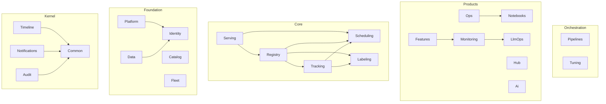

<!-- Generated by tools/MLPlatform.DocGen from code; do not edit. Regenerate: dotnet tools/MLPlatform.DocGen/bin/Debug/net11.0/mlp-docgen.dll . -->

# Modules and layers

Lower layers never depend on higher ones (gate MLPARCH001); arrows are the declared same-layer dependencies.

| Module | Layer | Requests | SQL folders | Shared SQL | Spec |
|---|---|---:|---|---|---|
| Common | Kernel | 0 |  | all | [M01-iam.md](../../cookbook/40-module/M01-iam.md) |
| Timeline | Kernel | 0 |  | all | [M03-scheduler.md](../../cookbook/40-module/M03-scheduler.md) |
| Notifications | Kernel | 5 | Notify | all | [M16-notifications.md](../../cookbook/40-module/M16-notifications.md) |
| Audit | Kernel | 1 | Audit |  | [M06-lineage-audit.md](../../cookbook/40-module/M06-lineage-audit.md) |
| Identity | Foundation | 23 | Identity | all | [M01-iam.md](../../cookbook/40-module/M01-iam.md) |
| Platform | Foundation | 4 | Platform |  | [M01-iam.md](../../cookbook/40-module/M01-iam.md) |
| Catalog | Foundation | 13 | Catalog |  | [M17-model-catalog.md](../../cookbook/40-module/M17-model-catalog.md) |
| Fleet | Foundation | 36 | Fleet | GetHostAsync, SetHostGpuYieldAsync, HostAlertTargetAsync, HostLastMetricsAsync | [M02-fleet.md](../../cookbook/40-module/M02-fleet.md) |
| Data | Foundation | 22 | Data | all | [M04-data.md](../../cookbook/40-module/M04-data.md) |
| Scheduling | Core | 16 | Sched | GetAttemptAsync, GetJobAsync, HostAttemptJobsAsync, JobsByIdsAsync, SetWorkloadTokenAsync, HostGpuAllocationsAsync, GpuJobMarksAsync | [M03-scheduler.md](../../cookbook/40-module/M03-scheduler.md) |
| Labeling | Core | 59 | Label | GetCurrentSchemaAsync | [M05-labeling.md](../../cookbook/40-module/M05-labeling.md) |
| Tracking | Core | 54 | Track | GetProjectAsync, GetRunByJobAsync, GetTrialByRunAsync | [M09-tracking.md](../../cookbook/40-module/M09-tracking.md) |
| Registry | Core | 29 | Registry | ForgetDeploymentAsync, GetModelVersionAsync, GetVersionDeviceAsync, GetVersionPrefixAsync | [M11-registry.md](../../cookbook/40-module/M11-registry.md) |
| Serving | Core | 20 | Serving | GetDeploymentAsync, GetDeploymentByJobAsync | [M12-serving.md](../../cookbook/40-module/M12-serving.md) |
| Ops | Products | 35 | Ops |  | [M03-scheduler.md](../../cookbook/40-module/M03-scheduler.md) |
| Notebooks | Products | 15 | Nb | GetServerByJobAsync | [M08-notebook.md](../../cookbook/40-module/M08-notebook.md) |
| LlmOps | Products | 13 | Llm |  | [M15-llmops.md](../../cookbook/40-module/M15-llmops.md) |
| Monitoring | Products | 9 | Monitor |  | [M13-monitoring-drift.md](../../cookbook/40-module/M13-monitoring-drift.md) |
| Features | Products | 12 | Feature |  | [M07-feature-store.md](../../cookbook/40-module/M07-feature-store.md) |
| Hub | Products | 9 | Hub |  | [M17-model-catalog.md](../../cookbook/40-module/M17-model-catalog.md) |
| Ai | Products | 17 | Ai |  | [M05-labeling.md](../../cookbook/40-module/M05-labeling.md) |
| Pipelines | Orchestration | 10 | Pipeline |  | [M14-pipelines-agents.md](../../cookbook/40-module/M14-pipelines-agents.md) |
| Tuning | Orchestration | 6 | Tune |  | [M10-hpo-automl.md](../../cookbook/40-module/M10-hpo-automl.md) |
