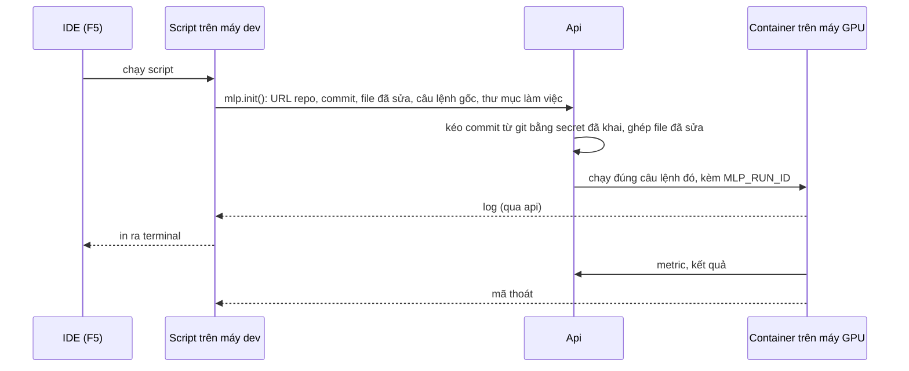
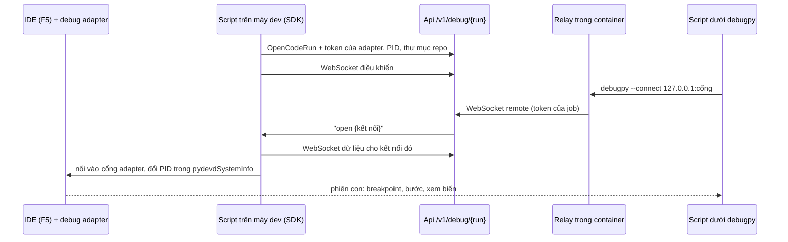

# Giải pháp: gắn SDK, điền `.env`, bấm F5

- Trạng thái: **đã chốt (D-53, 2026-11-23)**. G0 đạt; **G1–G5 đã làm và kiểm** (mục 9.1–9.5). **G7 (danh mục từ git, image sinh từ manifest, model tải lúc chạy) đã làm** (mục 12), còn chạy thật qua nền tảng. G6 chưa làm.
- Bản 2 (CLI nhiều lệnh, phiên SSH, file cấu hình IDE) bị chủ dự án bác vì quá phức tạp cho dev. Bản này thiết kế lại từ bốn yêu cầu ở mục 1. Phần máy chủ đã qua phản biện ở bản 2 được giữ, gom về mục 6.
- Ký hiệu: **[đã kiểm]** = đã đọc code hoặc tài liệu chính thức; **[chưa kiểm]** = phải làm thử trước khi cam kết.

## 1. Yêu cầu và câu trả lời

| Yêu cầu của chủ dự án | Giải pháp |
|---|---|
| Dev chỉ biết gắn SDK vào code | Một dòng: `mlp.init()`. Không manifest, không lệnh CLI, không file cấu hình IDE |
| Tham số điền vào `.env`, có thông tin máy trong cụm; không điền thì dùng máy dev | SDK tự đọc `.env`. Hai công tắc độc lập: có URL + key thì run được theo dõi trên web; có `MLP_MACHINE` thì chạy trên máy đó (mục 2.3) |
| F5 để chạy hoặc debug | F5 chạy script như bình thường. `mlp.init()` tự chuyển script sang máy GPU, đưa log về terminal. Khi F5 ở chế độ debug, tiến trình trên máy GPU tự nối vào đúng phiên debug đang mở (mục 4) |
| Cấu hình mỗi repo hoặc HF kèm secret để server tự kéo về | Quản trị viên khai một lần trên web: tiền tố URL + secret. Dev không bao giờ cầm secret của repo (mục 5) |

## 2. Dev thấy gì

### 2.1 Code

```python
import mlplatform as mlp
mlp.init()                                    # hai dòng đầu file; đây là phần bắt buộc

cfg   = mlp.params(epochs=30, lr=1e-4)        # tuỳ chọn: tham số chỉnh được từ web
model = mlp.model("hf://Qwen/Qwen3-4B")       # tuỳ chọn: trả về đường dẫn local
data  = mlp.dataset("./data")                 # tuỳ chọn: thư mục local hoặc "tên@phiên-bản"

for step in range(cfg.epochs):
    ...
    mlp.log({"loss": loss}, step=step)        # tuỳ chọn

mlp.save("outputs/")                          # tuỳ chọn: kết quả của run
```

Code không có nhánh `if` nào theo nơi chạy.

### 2.2 `.env`

```
MLP_API_URL=https://mlp.example.com
MLP_API_KEY=mlpk_...
MLP_MACHINE=gpu-01
```

| Biến | Ý nghĩa | Mặc định |
|---|---|---|
| `MLP_API_URL` + `MLP_API_KEY` | Bật theo dõi run trên web. Phải có cả hai | Không có: không theo dõi |
| `MLP_MACHINE` | Tên một máy trong cụm, hoặc `auto` để nền tảng chọn | `local`: chạy trên máy dev |
| `MLP_PROJECT` | Project nhận run | Tên repo; chưa có thì tự tạo |
| `MLP_GPU` | Số GPU | 1 |
| `MLP_IMAGE` | Image nền | Image mặc định của cụm |
| `MLP_FORWARD_ENV` | Tên các biến môi trường của máy dev cần mang theo (ví dụ `WANDB_API_KEY`) | Không mang gì |

- SDK tự tìm `.env` từ thư mục script đi lên. Biến môi trường thật thắng `.env`. Phải tự đọc vì VS Code không nạp `.env` khi chạy trong terminal theo mặc định [đã kiểm]; PyCharm và Zed cũng không tự nạp [chưa kiểm].
- Cấu hình sai (có key mà thiếu URL, `MLP_MACHINE` mà thiếu key, tên máy không tồn tại, máy đang offline) báo lỗi ngay, không lặng lẽ đổi nơi chạy.
- SDK cảnh báo nếu `.env` chưa nằm trong `.gitignore`. API key có phạm vi một workspace, thu hồi được.
- Hiện trạng: cụm chưa có khái niệm nhóm máy, job chỉ ghim được vào một máy cụ thể [đã kiểm]. Bản đầu chỉ nhận tên máy hoặc `auto`.

### 2.3 Hành vi khi bấm F5

| `.env` | Nơi chạy | Theo dõi trên web |
|---|---|---|
| Trống | Máy dev | Không. `mlp.log` in ra terminal, `mlp.save` giữ nguyên thư mục |
| URL + key | Máy dev | Có: run, metric, log, kết quả |
| URL + key + `MLP_MACHINE` | Máy GPU đã chọn | Có. Log hiện trực tiếp trong terminal của IDE |

Dòng đầu tiên SDK in ra luôn nói rõ đang ở trường hợp nào, ví dụ `mlp: chạy trên gpu-01 · project fire-detection · môi trường có sẵn · <link run>`. Một lỗi gõ trong `.env` vì thế lộ ra ngay.

Khi chạy trên máy GPU:

- **Dừng:** Ctrl+C hoặc nút Stop của IDE là dừng run. Mất kết nối (gập máy, rớt mạng, đóng IDE) thì run **vẫn chạy**; bấm F5 lại sẽ nối vào run đang chạy thay vì tạo run mới.
- **Mã thoát** của script local bằng mã thoát của run.
- Log đi theo từng dòng, trễ 1–2 giây. Thanh tiến trình kiểu tqdm không vẽ lại tại chỗ.

## 3. Tham khảo: ai đã làm kiểu này

| Công cụ | Gắn vào code | Chọn local hay từ xa | Tiến trình local | Debug từ xa trong IDE |
|---|---|---|---|---|
| ClearML [đã kiểm] | `Task.init()` + `task.execute_remotely(queue)` | Lời gọi trong code | Thoát; log xem trên web | Không |
| SageMaker `@remote` [đã kiểm một phần] | Decorator trên từng hàm | Có decorator; hạ tầng lấy từ `config.yaml` | Chờ, nhận log và giá trị trả về | Không |
| Modal [đã kiểm] | `@app.function`, gọi `.remote()` | `.remote()` hay `.local()` ở chỗ gọi | Chờ, nhận log | Chỉ pdb trên terminal |
| Ray [đã kiểm] | `ray.init()` | Có `RAY_ADDRESS` hay không | Driver vẫn chạy local, chỉ task đi xa | Cần extension VS Code của Ray |
| dstack [đã kiểm] | YAML + CLI | Lệnh | Gắn log | SSH vào máy |
| HF Jobs [đã kiểm] | `run_uv_job("script.py")` | Lời gọi | Job nền | SSH |

Kết luận:

- Không công cụ nào cho một script không sửa gì chạy từ xa chỉ bằng biến môi trường. ClearML gần nhất: một dòng khởi tạo, cả script được chạy lại ở máy xa. Đề xuất này theo mô hình đó và bỏ luôn lời gọi thứ hai: nơi chạy do `.env` quyết định.
- Ray cho thấy "không có địa chỉ thì chạy local" là quy ước người dùng ML đã quen.
- **Không công cụ nào cho breakpoint từ F5 dừng trong tiến trình ở máy xa mà không cần extension.** Đây là chỗ đề xuất này đi xa hơn các hãng, và cũng là rủi ro kỹ thuật lớn nhất (mục 4.2).

## 4. `mlp.init()` làm gì

### 4.1 Chạy từ xa



1. Đọc `.env`. Nếu đang ở trong container của nền tảng (có `MLP_RUN_ID`) thì chỉ bật ghi nhận rồi trả về: script chạy tiếp như thường.
2. Nếu `MLP_MACHINE` khác `local`: thu thông tin code (4.3), câu lệnh gốc (`sys.orig_argv`, nên `python -m gói.train --lr 1e-4` được giữ nguyên), thư mục làm việc tính từ gốc repo, các biến trong `MLP_FORWARD_ENV`; rồi gửi yêu cầu chạy.
3. Tiến trình local **không chạy phần còn lại của script**. Nó ở lại làm cầu nối: in log, chuyển lệnh dừng, cuối cùng thoát với mã thoát của run.
4. Trên máy GPU, cùng câu lệnh đó chạy từ đầu; `mlp.init()` rơi vào bước 1.

Vì cả script được chạy lại ở máy xa nên `import mlplatform as mlp; mlp.init()` phải là hai dòng đầu file. Mọi thứ đứng trước nó sẽ chạy hai lần. SDK cảnh báo khi thấy `torch` hoặc `wandb` đã được nạp trước `init()`.

### 4.2 Debug bằng F5

Cơ chế dựa trên cách debugpy xử lý tiến trình con [đã kiểm trong mã nguồn debugpy 1.8.20]:

- Khi F5, bộ chuyển đổi debug của IDE mở một cổng trên `127.0.0.1` và khởi chạy script kèm địa chỉ cổng đó và một mã truy cập. Script đọc được cả hai từ `pydevd.SetupHolder.setup`.
- Bất kỳ tiến trình Python nào gọi `debugpy.connect(địa chỉ, access_token=…, parent_session_pid=…)` tới cổng đó đều được ghép vào phiên debug đang mở như một tiến trình con. IDE tự mở phiên con; breakpoint, xem biến, bước từng dòng hoạt động như với tiến trình con thường.

Áp dụng:

1. `mlp.init()` thấy mình đang bị debug (`debugpy.is_client_connected()`), đọc địa chỉ và mã truy cập.
2. SDK mở một kênh chuyển tiếp qua api tới container, rồi nối đầu của mình vào cổng local của bộ chuyển đổi. Container không mở cổng nào ra mạng overlay (điểm bị bắt lỗi ở bản 2). Kênh này **chưa có sẵn** trong api; G0 chỉ thử một kênh TCP đơn giản. Hai cách làm cần so ở đầu G4:
   - Luồng gRPC hai chiều mới, container nối ra api. Hiện proto chưa có luồng hai chiều nào.
   - Dùng lại kênh dữ liệu sẵn có (api → agent → cổng loopback của máy GPU, như notebook). Khi đó run debug chạy ngoài mạng overlay, một GPU, và trong container có một tiến trình nhỏ nối hai đầu.
3. Script trên máy GPU khởi động dưới debugpy ở chế độ `--connect` tới kênh đó.
4. Đường dẫn file: nền tảng đặt biến `PATHS_FROM_ECLIPSE_TO_PYTHON` mà pydevd đọc [đã kiểm], ánh xạ thư mục trên máy dev sang thư mục trong container. Dev không phải khai gì. Cách này dùng được cả khi máy dev là Windows.
5. Ctrl+F5 (chạy không debug): không có cổng, SDK chạy từ xa bình thường.

Hỗ trợ theo IDE:

| IDE | Tình trạng |
|---|---|
| VS Code (và Cursor, Windsurf) | Có xử lý phiên con [đã kiểm trong mã nguồn extension]. Mục tiêu đầu tiên |
| Zed | Có xử lý `startDebugging` trong mã nguồn [đã kiểm], chưa thử |
| PyCharm | Dùng debugpy từ bản 2026.1; chưa rõ có nhận phiên con không [chưa kiểm] |

#### Kết quả làm thử G0 (2026-11-23)

Bản thử ở `tools/prototypes/g0-remote-debug/`. Một container Docker trên máy dev đóng vai máy GPU; một kênh TCP trong SDK đóng vai đường chuyển tiếp qua api. Thay cho VS Code là một client DAP không giao diện, gửi đúng chuỗi lệnh VS Code gửi khi bấm F5 (`initialize` → `launch` → `setBreakpoints` → `configurationDone`) và trả lời `startDebugging` như VS Code. Dùng debugpy 1.8.20 đi kèm extension VS Code ở cả hai đầu.

| Kiểm | Kết quả |
|---|---|
| F5: breakpoint trong file chính và trong module khác, chạy ở container | **Đạt.** Dừng đúng dòng, xem được biến, `next` hoạt động. Khung ngăn xếp trỏ về đường dẫn file trên máy dev nhờ `PATHS_FROM_ECLIPSE_TO_PYTHON`; dev không khai gì |
| Log và mã thoát | **Đạt.** Log của container hiện ở console của IDE; mã thoát 3 của script trong container thành mã thoát của phiên F5 |
| Ctrl+F5 (chạy không debug) | **Đạt.** SDK nhận ra không có debugger và chạy từ xa bình thường |
| Bấm Stop giữa lúc dừng ở breakpoint | **Đạt.** Bộ chuyển đổi kết thúc cả tiến trình xa; container tự thoát, không còn sót |
| Tiến trình con trong container (Pool `multiprocessing`, kiểu DataLoader) | **Đạt.** Mỗi worker thành một phiên con, breakpoint trong worker dừng được. Điều kiện: IDE xử lý `startDebugging` lồng nhau (VS Code có) |
| Hai container trong một phiên (train nhiều máy) | **Lỗi nếu để nguyên:** cả hai có PID 1, bộ chuyển đổi từ chối container thứ hai, container đó treo. **Sửa được:** đường chuyển tiếp đổi PID trong bản tin `pydevdSystemInfo` thành số duy nhất và đổi PID cha theo bảng ánh xạ. Đã thử: cả hai phiên lên, worker vẫn nối đúng cha |
| Độ trễ | Cùng máy: 1–3 ms mỗi lệnh. Thêm 80 ms mỗi chiều mỗi chặng: khoảng 250 ms mỗi thao tác (bước, xem ngăn xếp). Dùng được |
| Cảnh báo "frozen modules" của Python 3.12 | Chạy tiến trình xa với `-Xfrozen_modules=off` |

Hệ quả cho thiết kế:

- Đường chuyển tiếp **không chỉ chuyển byte**: nó phải hiểu khung DAP để đổi PID. Việc này nằm ở api (một chỗ), không ở IDE hay container.
- Kết thúc phiên debug kết thúc run là hành vi sẵn có của debugpy, không cần code.
- Mỗi container một kênh riêng, PID đổi theo kênh.

Chưa kiểm được ở G0, phải kiểm ở G4:

1. Zed và PyCharm thật (G0 chỉ mô phỏng VS Code). Zed có xử lý `startDebugging` trong mã nguồn; PyCharm chưa rõ.
2. Máy dev Windows (đường dẫn `C:\…` trong ánh xạ).
3. Đường chuyển tiếp thật qua api (luồng gRPC hai chiều hoặc kênh dữ liệu) và qua mạng thật.
4. GPU thật với `torchrun`/`accelerate`; G0 chỉ thử `multiprocessing`.
5. Breakpoint trong thư viện ở `site-packages` của container (mặc định `justMyCode` không bước vào).

Nếu IDE không hỗ trợ, SDK in một dòng nói rõ và chạy không breakpoint. Dev vẫn debug được bằng cách bỏ `MLP_MACHINE` để chạy trên máy mình.

### 4.3 Code và dữ liệu tới máy GPU thế nào

Dev không làm gì. SDK tự thu:

- URL của `git remote`, commit gần nhất đã có trên remote, và **nội dung đầy đủ của các file đã đổi so với commit đó** (gồm cả commit chưa push và file mới chưa `git add`, trừ file bị `.gitignore` loại), kèm danh sách file đã xoá. Gửi file nguyên vẹn, không gửi bản vá: ClearML gửi bản vá và đó là nguồn lỗi hay gặp nhất của họ.
- Server kéo commit gốc bằng secret đã khai (mục 5), ghép các file đã đổi, lưu thành một bản chụp bất biến có sha256. Run ghi commit, cờ `dirty`, sha256.
- Repo chưa được khai trên server, hoặc thư mục không phải git: SDK gửi cả cây file (giới hạn 100 MB, vượt thì liệt kê file lớn nhất).

Trên máy GPU, mỗi run có một bản sao ghi được của code, và thư mục làm việc giống trên máy dev (tính từ gốc repo). Script ghi `outputs/`, `runs/`, `lightning_logs/` như thường. Những gì ghi ra sẽ mất khi run kết thúc, trừ thư mục đưa vào `mlp.save(...)`.

**File bị `.gitignore` loại không đi theo**: dữ liệu, checkpoint, trọng số local. Đây là chỗ duy nhất dev phải biết:

- Dữ liệu local: `mlp.dataset("./data")`. Trên máy dev nó trả lại đúng đường dẫn đó. Khi chạy trên máy GPU, SDK tải thư mục lên một lần (băm nội dung, lần sau không tải lại) và trả về đường dẫn trong container.
- Dữ liệu đã có trên nền tảng: `mlp.dataset("tên@phiên-bản")`; cần URL + key.
- Nếu script chết vì không thấy một file mà trên máy dev có, SDK in thêm một dòng nêu tên file và gợi ý trên.

### 4.4 Môi trường

Không có file riêng của nền tảng. Server suy ra theo thứ tự:

1. `Dockerfile` ở gốc repo, nếu có.
2. `uv.lock`, rồi `requirements.txt`, rồi `pyproject.toml`: cài trên image nền (mặc định của cụm, hoặc `MLP_IMAGE`).
3. Không có gì: image nền mặc định.

Image được băm theo các file trên và dùng lại. Code không nằm trong image mà nằm trong một volume gắn lúc chạy, nên sửa code không dựng lại môi trường. `mlplatform` và `debugpy` do nền tảng thêm vào, dev không phải khai.

### 4.5 Các hàm tuỳ chọn

| Hàm | Máy dev, không theo dõi | Máy dev, có theo dõi | Máy GPU |
|---|---|---|---|
| `mlp.params(...)` | Giá trị mặc định, ghi đè bằng tham số dòng lệnh | Như bên, ghi vào run | Ghi đè được từ web khi chạy lại |
| `mlp.model(ref)` | Tải về bộ đệm HF của máy bằng đăng nhập HF của chính dev | Như bên, ghi tham chiếu đã giải vào run | Volume đã tải sẵn trên máy GPU, dùng secret của server |
| `mlp.dataset("./thư-mục")` | Trả lại đường dẫn | Trả lại đường dẫn, ghi băm vào run | Tải lên một lần, trả đường dẫn trong container |
| `mlp.dataset("tên@phiên-bản")` | Lỗi: cần URL + key | Kéo về bộ đệm | Volume dữ liệu trên máy GPU |
| `mlp.log(...)` | In ra terminal | Gửi lên run | Gửi lên run |
| `mlp.save(path)` | Giữ nguyên | Tải lên làm kết quả của run | Tải lên làm kết quả của run |

Không gọi `mlp.log` vẫn có metric nếu code ghi TensorBoard vào thư mục kết quả: nền tảng tự đọc.

### 4.6 Giới hạn

| Trường hợp | Hành vi |
|---|---|
| `python train.py`, `python -m gói.train`, tham số dòng lệnh, gói nhiều file | Hỗ trợ |
| Hydra | Hỗ trợ chạy đơn; multirun chạy tuần tự trong một run |
| `accelerate launch`, `torchrun` | `init()` chỉ chuyển đi xa ở tiến trình khởi đầu; ở các rank khác nó không làm gì |
| Notebook, ô `# %%` | `init()` in một dòng rồi chạy trên máy dev: không chạy lại được cả script |
| `input()`, `breakpoint()` kiểu pdb | Không có bàn phím ở máy xa; dùng F5 debug |
| Biến môi trường của máy dev | Không mang theo, trừ tên khai trong `MLP_FORWARD_ENV` |
| `init()` gọi trong module được import | Lỗi: phải gọi ở script chính |

## 5. Quản trị viên: khai repo và Hugging Face một lần

Trên web, trang **Nguồn**:

| Trường | Ví dụ |
|---|---|
| Loại | `git` hoặc `hf` |
| Tiền tố URL | `https://github.com/blogic/` hoặc `https://huggingface.co/meta-llama/` |
| Kiểu xác thực | Token HTTPS, khoá SSH (deploy key), GitHub App, token HF |
| Secret | Lưu mã hoá, không đọc lại được |

- Mô hình "tiền tố URL → secret" lấy từ Argo CD [đã kiểm]: một dòng phủ cả tổ chức, tiền tố dài nhất thắng.
- Khi dev bấm F5, SDK gửi URL `git remote` (dạng ssh và https được quy về một). Server tự chọn secret khớp. Không khớp thì báo lỗi nêu đúng tiền tố cần khai, trước khi xếp hàng GPU.
- `mlp.model("hf://…")` dùng cùng bảng này. Model có điều kiện (gated) cần token của tài khoản đã chấp nhận điều khoản; lỗi 403 được báo ngay lúc nộp.
- Secret chỉ api đọc. Không bao giờ vào container chạy code của dev.

Cùng trang này dùng để **đưa một repo vào danh mục** cho người không dùng IDE: chọn repo, ref (branch, tag hoặc commit), đường dẫn script. Trên web, mục đó chạy được bằng một nút; tham số lấy từ `mlp.params(...)` trong code. Mỗi lần chạy, server đổi ref thành commit SHA và lưu lại.

## 6. Bên trong server

Phần này dev không thấy. Các điểm dưới đã được đối chiếu code ở bản 2.

### 6.1 Hiện trạng phải đổi [đã kiểm]

- `recipes/` đóng trong image api; api đọc từ đĩa lúc khởi động và lúc build image (`api.Dockerfile:7`, `SyncBuiltinRecipes.cs`, `HostContainers.cs:90-115`).
- Image băm theo toàn bộ file recipe, nên đổi một dòng code là build lại 10–30 phút.
- Không có bảng nguồn, phiên bản, bản chụp; không có code nào lấy nguồn từ git.
- Model `hf://` và `gdrive://` trong manifest hiện **không được tải ở đâu cả**; chỉ `https://` được tải (`StartTraining.cs:127-137`).
- API key `mlpk_` là một phiên đăng nhập có toàn quyền của người tạo.
- Không có RPC log dạng luồng; SDK Python và C# hiện chỉ gọi endpoint suy luận.

### 6.2 Thay đổi

| Việc | Cách làm |
|---|---|
| Lấy nguồn git | Control plane không chạy được container và image api không có `git`. Giai đoạn đầu api tải gói nén qua API HTTPS của GitHub, GitLab, Gitea; HF dùng `HfHub` sẵn có. Git bất kỳ và SSH: sidecar `source-fetcher` ở giai đoạn sau |
| Bản chụp | Bảng `catalog.sources` (tiền tố + secret), `catalog.snapshots` (sha256, xuất xứ, workspace). Run, phiên bản model, deployment ghi sha256 của bản chụp |
| Code tới container | Agent tạo volume `mlp-src-{sha}` bằng `ContainerRunOnce`, gắn chỉ đọc. Dùng chung cho train, serve, export |
| Môi trường | Image `mlp/env:{băm}` theo các file ở 4.4, dựng trên máy GPU như hiện nay. `Dockerfile` của dev có `COPY` thì ngữ cảnh build lấy từ volume code |
| Model | Tham chiếu được giải thành commit SHA lúc nộp. Mỗi tham chiếu một volume `mlp-ref-{sha}` trên máy GPU (theo workspace nếu riêng tư), nạp bởi một container tải riêng; token đưa bằng file, không bằng biến môi trường. Không sao chép về S3 trừ khi bấm "ghim về nền tảng" (`HubImporter` sẵn có) |
| Run không có recipe | Hiện run chỉ sinh ra từ `StartTraining` kèm job, cột `recipe`, `variant`, `task` bắt buộc. Cần: `CreateRun`, `FinishRun`, nhịp tim để run local chết không treo ở trạng thái "đang chạy"; tải kết quả và gửi log bằng API key của người dùng (hiện chỉ token của workload làm được) |
| Job từ repo | `JobSpec` thêm bản chụp, câu lệnh, thư mục làm việc. SDK Python tự báo metric và kết quả, việc mà `mlp-shim` đang làm cho recipe có manifest |
| Chọn máy | Đổi tên máy thành id lúc nộp; từ chối máy offline trước khi xếp hàng (hiện job ghim máy bỏ qua kiểm tra này) |
| Log về terminal | RPC `FollowJobLogs` dạng luồng. `LogStore` hiện giữ 2.000 dòng trong bộ nhớ và lọc theo thời gian: cần số thứ tự cho từng dòng và phần bù từ S3 để nối lại không mất dòng. Log của bước dựng môi trường phải đi cùng luồng này |
| Kênh debug | Một trong hai cách ở 4.2, chọn ở đầu G4; phải đổi PID trong khung DAP; đầu dev xác thực bằng API key |
| API key | Thêm workspace, phạm vi, hạn dùng; tài khoản dịch vụ cho CI |

### 6.3 Bảo mật

| Điểm | Biện pháp |
|---|---|
| Chạy code tuỳ ý của dev | Đã chấp nhận ở D-45; quyền theo vai trò workspace; audit mọi lần nộp |
| Secret git, token HF | Không vào container của dev; đưa bằng file |
| Tải code lên | Server kiểm kích thước và sha256; khi giải nén từ chối `..`, đường dẫn tuyệt đối, symlink |
| URL nguồn | Chỉ `https` (và `ssh` khi có sidecar); api chung mạng với overlay nên chặn dải địa chỉ riêng và chuyển hướng |
| Kênh debug | Container chỉ nối ra; mã truy cập debug chỉ đi qua api; kênh đóng khi run kết thúc |
| `.env` | Cảnh báo khi chưa gitignore; key có phạm vi và hạn dùng |

## 7. Recipe hiện có và các ngôn ngữ khác

- **Recipe dùng `mlp-recipe.yaml` vẫn giữ**, cho trường hợp bọc repo của bên thứ ba mà không sửa code của họ (D-FINE, SAM2, YOLO…). Chúng chuyển sang một repo git riêng, khai trên trang Nguồn như mọi repo khác; image api không còn chứa `recipes/`. Dev viết code của mình thì không cần manifest.
- Canvas (D-49) tiếp tục làm việc trên recipe có manifest. Revision ghi thêm sha256 của bản chụp, để trial không bị dùng lại sau khi code đổi.
- **"Gắn SDK rồi F5" áp dụng cho Python**, vì code train là Python. SDK C#, Rust, TypeScript, Go là client để dịch vụ khác điều khiển nền tảng: chạy một mục trong danh mục ở một ref, chờ kết quả, gọi model đã deploy. Các SDK này sinh từ proto bằng Buf, thêm một lớp mỏng viết tay.
- CLI `mlp` không nằm trên đường đi của dev. Nó còn lại cho CI và quản trị.

```csharp
await using var mlp = new MlpClient();
var run = await mlp.Runs.SubmitAsync(new RunSpec { Project = "fire-detection", Source = "blogic/fire-train@main", Script = "train.py" }, ct);
var result = await run.WaitAsync(TimeSpan.FromHours(1), ct);
```

## 8. Quyết định (đã chốt theo đề xuất, D-53)

| # | Câu hỏi | Đề xuất |
|---|---|---|
| Q1 | Hai công tắc trong `.env` (theo dõi; nơi chạy) đúng ý chưa? | Đúng như bảng 2.3 |
| Q2 | Kiểu gắn SDK | Một dòng `mlp.init()`, cả script chạy lại ở máy xa. Không dùng decorator trên từng hàm |
| Q3 | Lời hứa về F5 debug | G0 đạt với giao thức của VS Code. Hứa cho VS Code (và Cursor) từ G4; Zed và PyCharm sau khi thử thật |
| Q4 | Recipe có manifest | Giữ cho repo bên thứ ba, chuyển sang repo git riêng |
| Q5 | Run từ code chưa commit có được deploy không? | Train và đăng ký được, có nhãn `dirty`; deployment cho người dùng ngoài yêu cầu commit sạch |
| Q6 | Model tải về có lưu bản sao trong S3 không? | Mặc định không; có thao tác "ghim về nền tảng" |
| Q7 | Thứ tự SDK client | C# → TypeScript → Rust → Go |
| Q8 | `gdrive://` (12 biến thể họ DETR) | Chép các file đó sang repo model trên HF hoặc URL `https://` có sha256 |

## 9. Lộ trình

| Giai đoạn | Nội dung | Nghiệm thu bằng hành trình thật |
|---|---|---|
| G0 ✔ | Làm thử F5 debug xuyên kênh chuyển tiếp: **đạt** (4.2). Còn chờ chủ dự án trả lời Q1–Q8 | Breakpoint dừng trong tiến trình chạy ở container, cả ở worker con |
| G1 ✔ Máy dev có theo dõi | SDK Python: `init`, `params`, `log`, `save`, tự đọc `.env`; run không có recipe (`OpenCodeRun`, `FinishCodeRun`, nhịp tim, tải kết quả bằng API key); API key theo workspace | Thêm một dòng vào script có sẵn, điền URL và key, F5: run hiện trên web với metric |
| G2 ✔ Chạy từ xa | Trang Nguồn (tiền tố + token); server tải commit qua HTTPS từ GitHub/GitLab/Gitea; bản chụp; môi trường tự suy từ `requirements.txt` + `MLP_IMAGE`; log về terminal | Thêm `MLP_MACHINE`, F5: script chạy trên máy cụm, log về terminal, Ctrl+C dừng run. Sửa một dòng, F5 lại: không dựng lại môi trường |
| G3 ✔ (phần SDK) Model và dữ liệu | `mlp.model("hf://…")`, `mlp.dataset("./thư-mục")` và `mlp.dataset("tên@N")`; volume đệm theo workspace trên máy cụm; token HF của workspace | Tải lần đầu, lần hai dùng lại; model gated báo lỗi trước khi gửi run. Phần recipe có manifest (shim tải `hf://`, whisper) chưa làm |
| G4 ✔ F5 debug | Kênh chuyển tiếp WebSocket qua api, đổi PID trong khung DAP, debugpy trong ảnh môi trường, ánh xạ đường dẫn | Breakpoint dừng trong container ở file chính, module khác và worker con; Stop thì run "huỷ" |
| G5 ✔ (phần chạy từ web) Danh mục từ repo | Tab Repo trong project: khai script của repo (branch, máy, GPU, image), chạy với ref và tham số bất kỳ. Chưa chuyển recipe dựng sẵn sang repo git, chưa gỡ `RecipesDir` | Người không dùng IDE chạy `karpathy/micrograd` ở `master` rồi ở một commit cũ từ web; mỗi run ghi đúng commit |
| G6 SDK client | Sinh C#, TypeScript, Rust, Go từ proto; tài khoản dịch vụ | Một job CI nộp run ở một ref, chờ, nhận kết quả |

G1 nhỏ nhất và dùng được ngay sau khi xong. G2 là phần lớn nhất. G4 chỉ làm khi G0 đạt.

### 9.1 G1 đã làm (2026-11-23)

| Phần | Nội dung |
|---|---|
| CSDL | `track.runs` thêm `origin` (`recipe` \| `code`), `host_name`, `code` (repo, commit, branch, dirty, script, argv, Python), `exit_code`, `heartbeat_at`. `identity.sessions` thêm `key_workspace_id` |
| API | `TrackingService.OpenCodeRun`, `HeartbeatCodeRun`, `FinishCodeRun`, `SetCodeRunParams`. `RuntimeService.CreateArtifactUploads`/`CompleteArtifacts` nhận API key cho run từ code (link tải lên dùng địa chỉ công khai). `LogMetrics` lấy metric đầu tiên làm metric chính khi run chưa có. `CreateApiKey` nhận `workspace_id` |
| Phân quyền | Key gắn workspace chỉ thấy và chỉ thao tác trong workspace đó; không tạo được key mới |
| Nền | `CodeRunJanitor`: run từ code im nhịp tim quá 90 giây thì thành thất bại (không có mã thoát) |
| Web | Trang run và danh sách run hiển thị run từ code: script, máy, commit, nhánh, thay đổi chưa commit, mã thoát, nhịp tim; ẩn nút "nấu lại", tab log. Tạo API key chọn workspace và hiện sẵn khối `.env` |
| SDK Python | `sdk/python/mlplatform/`: `init`, `params`, `log`, `save`, tự đọc `.env`. **Chỉ dùng thư viện chuẩn**: gọi api bằng gRPC-Web qua HTTP/1.1 với vài bản tin protobuf tự mã hoá, nên `MLP_API_URL` chính là địa chỉ trang web và dev không phải cài thêm gói nào có thể đụng môi trường train |

Đã kiểm trên stack thử (Postgres + S3 trong Docker, api từ mã nguồn), bằng một repo git mẫu:

| Trường hợp | Kết quả |
|---|---|
| Không có `.env` | Chạy trên máy dev, metric in ra terminal |
| Thiếu một trong hai biến, hoặc có `MLP_MACHINE` | Báo lỗi ngay, nêu tên biến và file `.env` |
| Key gắn `lab` | Run #1 trong `lab/fire-train`, project tự tạo; tham số ghi đè từ dòng lệnh; 4 bước × 2 metric; 2 file kết quả tải về đúng nội dung; token trong URL git bị gỡ |
| `sys.exit(3)` / Ctrl+C / `kill -9` | Thất bại mã 3 / huỷ mã 130 / thất bại sau khi mất nhịp tim |
| Key mọi workspace, không có `MLP_WORKSPACE` | Lỗi nêu danh sách workspace để chọn; có `MLP_WORKSPACE=research` thì chạy |
| Key gắn `lab` chọn `research` / tạo key mới | Bị từ chối |
| Trang web | Run hiện script, commit, nhánh, "thay đổi chưa commit", máy, Python, mã thoát, biểu đồ metric, tham số, file kết quả; danh sách run so sánh được metric; trang API key có ô chọn workspace |
| Cổng kiểm dự án (`gates/run.sh`) | Xanh: buf lint/breaking, CodeGate, build `-warnaserror`, tài liệu sinh khớp code, tsc |

Giới hạn còn lại của G1:

- Run từ code chưa có log trên web (log vẫn ở terminal của dev).
- `kill -9` mất tối đa 2 giây metric chưa kịp gửi.
- Mã thoát chỉ bắt được qua `sys.exit(...)` và ngoại lệ chưa xử lý; `exit()` dựng sẵn hoặc `raise SystemExit(n)` được ghi là thành công.
- Trang project vẫn hiện dải so sánh của luồng recipe ("khác tập validation") cho các run từ code, và nút "Train mới" dẫn vào canvas recipe.

### 9.2 G2 đã làm (2026-11-23)

| Phần | Nội dung |
|---|---|
| Chạy từ xa | `OpenCodeRun` nhận thêm `remote` (máy, GPU, image nền, bản chụp, thư mục làm việc, câu lệnh, biến chuyển tiếp, `requirements.txt`). Server tạo job ghim vào máy (hoặc `auto`) và run gắn với job |
| Bản chụp | `CreateCodeSnapshotUpload`: gói `tar.gz` đặt tên theo SHA-256 trong S3 (`{ws}/code/`); đã có thì không tải lại |
| Môi trường | Ảnh `mlp/code-env:{băm}` dựng ngay trên máy bằng `ImageBuild`: image nền + `pip install -r requirements.txt` + SDK. Mã băm gồm image nền, `requirements.txt` và dấu vân tay của SDK; sửa code không đổi mã băm nên không dựng lại |
| Trong container | `python -m mlplatform.launch` tải bản chụp, giải nén vào `/work`, chạy đúng câu lệnh của máy dev (kể cả `python -m gói`). SDK nhận ra mình đang ở trong job và báo metric, tham số, file kết quả bằng token của job qua `MLP_API_HTTP` |
| Nguồn code (G2b) | Bảng `track.code_sources` (tiền tố URL + token mã hoá), quyền `source.manage`. `MatchCodeSource` cho SDK biết server có tự kéo được repo không. Server tải archive của commit (cache S3), bỏ file đã xoá, chồng file đã đổi, đóng gói cố định |
| SDK | Repo khớp nguồn và commit gốc đã push: chỉ gửi file đã đổi so với commit đó (gồm commit chưa push, file chưa `git add`) cùng danh sách file đã xoá. Không khớp hoặc chưa push: gửi cả cây (tối đa 100 MB, không bao giờ gửi `.env`). Máy dev theo dõi log (1–2 giây), in trạng thái hàng đợi; Ctrl+C dừng run, Ctrl+C lần nữa thì bỏ theo dõi; thoát với mã thoát của run |
| Web | Run từ xa có tab log, tiến độ, máy; Cài đặt → Tích hợp có mục Nguồn code |

Đã kiểm với agent và Ray chạy trên chính máy này (máy "Raidens-MacBook-Pro" trong workspace `lab`):

| Trường hợp | Kết quả |
|---|---|
| F5 với `MLP_MACHINE` | Gửi 3 file, dựng môi trường có `six` từ `requirements.txt`, chạy trong container, log về terminal, lưu 2 file kết quả; khoảng 10 giây |
| Sửa một dòng rồi F5 lại | Môi trường "đã có sẵn"; cả vòng 4 giây |
| `sys.exit(3)` từ xa, biến chuyển qua `MLP_FORWARD_ENV` | Máy dev thoát mã 3 |
| Ctrl+C khi run đang chạy | Run huỷ, máy dev thoát mã 130, không sót container |
| Tham số `--epochs 30` trên dòng lệnh | Tới container và được ghi vào run |
| Tên máy sai / `auto` | Lỗi kèm danh sách máy / tự chọn máy |
| Repo `github.com/octocat/Spoon-Knife` đã khai nguồn: sửa `README.md`, xoá `styles.css`, thêm `train.py` | Máy dev gửi 2 file; container thấy `index.html` lấy từ GitHub đúng commit, `README.md` đã sửa, không có `styles.css` |
| Có commit cục bộ chưa push | Server lấy commit đã push gần nhất; phần commit cục bộ đi theo nhóm file đã đổi |
| Cổng kiểm dự án | Xanh |

Giới hạn còn lại của G2:

- Repo riêng tư có token: mã đã có nhưng chỉ kiểm với repo công khai trên GitHub; đường GitLab và Gitea chưa kiểm.
- Môi trường chỉ suy từ `requirements.txt` và `MLP_IMAGE`; chưa dùng `Dockerfile` ở gốc repo, `uv.lock` hay `pyproject.toml`.
- Mất kết nối giữa chừng thì máy dev cứ thử lại và run vẫn chạy; chưa có "F5 lại thì nối vào run đang chạy".
- F5 ở chế độ debug với máy xa: chạy không breakpoint (G4).
- Log lấy theo chu kỳ 1 giây từ bộ nhớ của api (giữ 2.000 dòng mỗi lượt chạy); api khởi động lại thì mất phần log cũ.
- Bản chụp và phần ghép làm trong bộ nhớ api, giới hạn 200 MB.
- `MLP_GPU` mặc định là 1; máy không có GPU phải đặt `MLP_GPU=0`, nếu không job sẽ chờ mãi.

### 9.3 G3 đã làm (2026-11-23)

| Phần | Nội dung |
|---|---|
| `mlp.model("hf://owner/name[@rev][#file=path]")` | Trả về thư mục (hoặc file) trên máy đang chạy. Không theo dõi: SDK hỏi thẳng Hugging Face, dùng `HF_TOKEN` của dev nếu có. Có theo dõi hoặc trong container: api giải tham chiếu bằng **token HF của workspace** (Cài đặt → Tích hợp). Repo công khai thì trả link Hub ghim commit; có token thì trả link đã ký của Hub, hoặc nội dung file nhỏ, nên token không rời api |
| `mlp.dataset("./data")` | Trên máy dev trả lại đúng đường dẫn. Khi chạy từ xa, SDK quét các lời gọi `mlp.dataset("…")` viết bằng chuỗi trong code, đóng gói thư mục đó (kể cả khi bị gitignore, tối đa 5 GB), tải lên một lần theo SHA-256; container giải nén vào volume đệm |
| `mlp.dataset("tên@N")` | Dataset của nền tảng: api trả link tải từng file (link cho container hoặc cho máy dev tuỳ người gọi); tải một lần theo phiên bản |
| Bộ đệm | Máy cụm: volume `mlp-models-{ws}` và `mlp-codedata-{ws}` gắn vào mọi run từ code của workspace đó. Máy dev: `~/.cache/mlplatform` (`MLP_CACHE` để đổi). Tải vào thư mục tạm rồi đổi tên, nên hai run cùng lúc không thấy nửa chừng |
| Kiểm trước khi gửi | Khi chạy từ xa, SDK giải trước các `mlp.model("hf://…")` viết bằng chuỗi. Model của script đang chạy mà lỗi (gated, không tồn tại) thì dừng ngay; model ở file khác thì chỉ cảnh báo |

Đã kiểm (model `hf-internal-testing/tiny-random-bert`, 28 MB; dataset `fire-mini@1` tạo qua API):

| Trường hợp | Kết quả |
|---|---|
| Máy dev, không theo dõi / có theo dõi | Lần đầu tải 10 file 28 MB, lần hai "cached" |
| Máy cụm, lần đầu | Tải model, nhận thư mục `data/` từ máy dev (4 file, đang bị gitignore), 18 giây |
| Máy cụm, lần hai | Model và dữ liệu đều dùng lại từ volume, 6 giây |
| `mlp.dataset("fire-mini@1")` ở máy dev và máy cụm | Đúng 2 file; lần hai ở máy cụm "cached"; `@9` báo "không có phiên bản 9" |
| Model gated `meta-llama/Llama-3.2-1B` không token | Báo lỗi rõ ở cả ba chế độ; khi chạy từ xa thì dừng trước khi gửi run |
| Cổng kiểm dự án | Xanh |

Giới hạn còn lại của G3:

- Chưa làm phần recipe có manifest (§5): shim chưa tải biến thể `hf://`, chưa gỡ backbone khỏi Dockerfile, chưa xử lý `gdrive://` (Q8). Việc này cần build image recipe nặng (whisper, D-FINE) nên chưa thử trên máy này.
- Chưa có tham chiếu `mlp://` (model trong registry) và `s3://`.
- Đường có token HF (repo riêng tư, gated đã chấp nhận) có mã nhưng chưa thử vì workspace thử chưa có token.
- Thư mục dữ liệu local chỉ được gửi khi đường dẫn viết thẳng bằng chuỗi trong `mlp.dataset("…")`; đường dẫn ghép từ biến thì không thấy.
- Gói dữ liệu local làm trong bộ nhớ của máy dev; thư mục rất lớn sẽ tốn RAM.
- Chưa có dọn volume đệm theo dung lượng.

### 9.4 G4 đã làm (2026-11-23)

Chọn cách: **WebSocket qua api**, không cần cổng nào mở ra ngoài container và không cần thêm gói Python nào ở máy dev.



| Phần | Nội dung |
|---|---|
| Api | `/v1/debug/{run}/control`, `/dev/{kết nối}` (API key của dev), `/remote` (token của job). `DebugRelay` ghép từng kết nối của container với một socket dữ liệu của dev. Kênh điều khiển đóng mà chưa nhận "done" thì run bị huỷ; run vừa thất bại trong một phút vì debugger bị dừng cũng được ghi là huỷ |
| Container | `mlplatform.launch` khởi động relay (tiến trình riêng, không bị debugger theo dõi) rồi chạy câu lệnh dưới `debugpy --connect --adapter-access-token --parent-session-pid`; `PATHS_FROM_ECLIPSE_TO_PYTHON` ánh xạ thư mục repo trên máy dev sang `/work`. Ảnh môi trường cài sẵn `debugpy==1.8.20` |
| Máy dev | SDK nhận ra F5 đang debug (`pydevd.SetupHolder`), mở kênh điều khiển, nối từng kết nối vào cổng adapter của IDE, đổi PID thành số duy nhất và giữ liên kết cha–con. Client WebSocket tự viết trên thư viện chuẩn |

Đã kiểm bằng client DAP không giao diện gửi đúng chuỗi lệnh VS Code gửi khi bấm F5, debugpy 1.8.20 của extension VS Code, máy cụm thử trên chính máy này qua api thật:

| Trường hợp | Kết quả |
|---|---|
| F5: breakpoint ở `train.py` và `helper.py` | Dừng đúng dòng trong container, khung ngăn xếp trỏ về file trên máy dev, xem được biến; mỗi lệnh khoảng 45 ms, bước `next` khoảng 0,2 giây |
| Run tự kết thúc với `sys.exit(3)` | Phiên F5 thoát mã 3; run "thất bại" |
| Bấm Stop khi đang dừng ở breakpoint | Container dừng, không sót; run "huỷ" |
| Ctrl+F5 | Chạy từ xa không debug, mã thoát 3 |
| Script sinh 2 worker (`multiprocessing`) | Mỗi worker thành một phiên con, breakpoint trong worker dừng được |
| Cổng kiểm dự án | Xanh |

Giới hạn còn lại của G4:

- Chưa thử trong VS Code, Zed, PyCharm thật (chỉ giả lập giao thức VS Code); chưa thử máy dev Windows, GPU thật với `torchrun`, mạng thật giữa máy dev và api.
- `debugpy` trong ảnh ghim 1.8.20; IDE dùng bản khác xa có thể không khớp giao thức.
- Nhiều container trong một phiên (train nhiều máy) dùng chung bảng đổi PID, PID cha có thể ghép nhầm giữa các container.
- Token của debug adapter nằm trong spec của job (CSDL) trong lúc run chạy; nó chỉ dùng được qua relay đã xác thực, nhưng vẫn là dữ liệu nhạy cảm.
- Breakpoint trong thư viện ở `site-packages` của container chưa thử.

### 9.5 G5 đã làm (2026-11-23)

| Phần | Nội dung |
|---|---|
| CSDL | `track.code_entries`: project, tên, repo, ref mặc định, script, máy, GPU, image nền |
| API | `ListCodeEntries`, `CreateCodeEntry` (repo phải nằm dưới một nguồn code), `DeleteCodeEntry`, `RunCodeEntry` (ref, máy, tham số) |
| Server | Đổi ref thành commit qua API của GitHub/GitLab/Gitea; tải commit (cache S3), dựng bản chụp không cần file nào từ máy dev; đọc `requirements.txt` trong bản chụp để dựng môi trường; tham số thành `--tên giá-trị` (đúng dạng `mlp.params` đọc); run ghi repo, commit, ref |
| Web | Tab **Repo** trong trang project: bảng script; sheet "Thêm script" (tên, repo, branch, script, máy, GPU, image nền); sheet "Chạy" (branch/tag/commit, máy, tham số `tên=giá-trị` mỗi dòng), xong thì mở trang run |

Đã kiểm trên web thật (khung trình duyệt), nguồn `https://github.com/karpathy`, máy cụm thử trên chính máy này:

| Trường hợp | Kết quả |
|---|---|
| Thêm script `micrograd/engine.py` của `karpathy/micrograd`, branch `master` | Có trong bảng |
| Bấm Chạy ở `master` | Run #4 xong; commit `7bc720e9` đúng đầu nhánh trên GitHub lúc chạy |
| Chạy ở `c34adac4` (commit cũ) | Run #5 xong, ghi commit `c34adac4` |
| Branch không tồn tại | Báo lỗi ngay trong sheet: "'no-such-branch' not found in …" |
| Cổng kiểm dự án | Xanh |

Chưa làm trong G5 và lý do:

- **Chuyển recipe dựng sẵn (`recipes/`) sang một repo git riêng, gỡ `Catalog:RecipesDir` khỏi image api và compose.** Việc này cần tạo repo mới trên GitHub (thao tác ra ngoài, cần chủ dự án đồng ý và chọn nơi đặt) và đổi đường build image recipe có manifest (shim, `HostContainers.RecipeImage`, canvas D-49). Nên làm cùng phần recipe còn dở của G3 (shim tải `hf://`).
- Chạy từ web chỉ dùng được với repo nằm dưới một nguồn code đã khai; repo không khai nguồn thì phải chạy từ IDE (G2a).
- Script viết bằng SDK mới có metric và kết quả; script thường vẫn chạy, có log và trạng thái, nhưng không có metric.

## 12. G7: Danh mục lấy từ git và Hugging Face (2026-11-24)

G1–G5 làm phần "dev gắn SDK và F5", nhưng **danh mục chưa đổi**: image api vẫn chứa `recipes/`, mỗi recipe có một Dockerfile viết tay tự `git clone` repo gốc và `curl` backbone khi build. G7 sửa đúng ba yêu cầu gốc còn thiếu.

### 12.1 Mục tiêu (đối chiếu yêu cầu gốc)

| Yêu cầu gốc | G7 làm gì | Nghiệm thu |
|---|---|---|
| Không tải sẵn model về server | Bỏ mọi lệnh tải model khỏi build image. Backbone và weight tải lúc job chạy, kiểm sha256, giữ trong volume đệm của workspace trên máy GPU | Image recipe không chứa file `.pth`; lần chạy đầu tải, lần hai dùng lại |
| Recipe lấy từ git hoặc HF, chỉ định branch | Danh mục đọc từ một repo git ở một branch (`Catalog:Source`, `Catalog:Ref`; mặc định repo này, `main`). Mỗi recipe ghi repo gốc, branch và commit; server tự tải repo gốc ở commit đó | Image api không còn `recipes/`; đổi branch danh mục rồi đồng bộ thì danh mục đổi theo |
| Người dùng muốn chỉnh thì tự fork | Danh mục chỉ trỏ tới repo gốc. Muốn chỉnh: fork repo gốc hoặc repo danh mục, đổi URL/branch | Trang Model Catalog hiện repo, branch, commit của từng recipe |

### 12.2 Vấn đề của Dockerfile hiện tại

| Vấn đề | Hậu quả |
|---|---|
| `git clone` cả lịch sử repo bên trong `docker build` | Phụ thuộc mạng trong bước build, không giới hạn thời gian; dễ treo |
| `curl` backbone (≈550 MB) vào image | Trái yêu cầu; image phình; mỗi lần đổi recipe tải lại |
| `pip install --no-cache-dir`, không có cache của BuildKit | Mỗi lần build lại tải lại nhiều GB wheel |
| `pip install flash-attn … \|\| true` | Dịch flash-attn từ mã nguồn hàng giờ; lỗi bị nuốt, image "xong" mà thiếu thư viện |
| 15 Dockerfile viết tay, khác nhau từng chút | Khó kiểm, khó sửa đồng loạt |

### 12.3 Thiết kế

- **Image sinh từ manifest**, không còn Dockerfile viết tay. Manifest khai `environment.base`, `apt`, `pip`, `installSource` (ví dụ `-e .`), `env`, `check`; recipe-local files và `_shared` chép vào như cũ.
- **Server tải mã nguồn**, không phải `docker build`: archive của repo gốc ở commit đã ghim (và các repo phụ, file lẻ có sha256) được tải qua HTTPS, đệm trong S3, đưa vào build context. Tag image = hash của manifest + file + commit, nên đổi commit là ra image mới.
- **pip dùng cache mount của BuildKit** để build lại không tải lại wheel.
- **Model tải lúc chạy**: `source.downloads` (url, sha256, path) do mlp-shim tải vào `/mnt/mlp-models/blobs/<sha256>` (volume `mlp-models-<ws>`) rồi liên kết tới path. Inspection của canvas không cần backbone.
- **Danh mục từ git**: api tải archive của repo danh mục ở `Catalog:Ref`, giải nén `recipes/` vào thư mục đệm theo commit, chạy `SyncBuiltinRecipes`. Có nút đồng bộ lại. `Catalog:RecipesDir` chỉ còn cho dev muốn sửa recipe tại chỗ.

### 12.4 Các bước (mỗi bước rà lại bảng 12.1 trước khi sang bước sau)

| Bước | Nội dung | Trạng thái |
|---|---|---|
| S1 | Sinh image từ manifest; server tải mã nguồn; pip cache | ✔ `RecipeDockerfile`, `RecipeSourceStore`, agent `BuildFetcher` (archive lớn hơn khung 16 MB nên agent tự tải, kiểm sha256) |
| S2 | Model tải lúc chạy (shim + volume đệm) | ✔ code: mlp-shim tải `source.downloads` vào `/mnt/mlp-models/blobs/<sha256>`, job recipe được gắn volume `mlp-models-<ws>` |
| S3 | Chuyển D-FINE và hf-text, chạy thử trên máy GPU | ✔ dựng thật trên máy GPU bằng Dockerfile sinh ra: D-FINE 1,4 phút, 3,6 GB; hf-text 5,3 phút, 4,6 GB; không có file `.pth` trong image |
| S4 | Chuyển 13 recipe còn lại, xoá Dockerfile viết tay | ✔ 15/15 manifest dùng `environment.base`; 15 Dockerfile đã xoá. Dựng thật thêm rt-detrv4 (2 repo), sam2 (`-e`), generic-onnx (image CUDA), tabular-gbdt. Chưa dựng: deimv2, hf-auto, hf-llm-sft, whisper, rf-detr, ultralytics-yolo, 3 vibevoice |
| S5 | Danh mục từ git, gỡ `recipes/` khỏi image api | ✔ `CatalogSource`: api tải repo này ở `main` và đồng bộ 15 recipe (đã chạy ở máy dev: commit `d485dfb`). `api.Dockerfile` và compose không còn `recipes/`; `Catalog:RecipesDir` chỉ còn cho dev |
| S6 | Trang Model Catalog: nguồn, branch, commit, đồng bộ | ✔ dòng nguồn + nút Đồng bộ (Instance Admin); tab Nguồn của recipe: repo gốc @ commit, Fork, file tải khi chạy, image nền, apt, pip |
| S7 | Rà lần cuối theo bảng 12.1 | xem 12.5 |

### 12.5 Rà theo mục tiêu (2026-11-24)

| Mục tiêu | Đạt | Còn thiếu |
|---|---|---|
| Không tải sẵn model về server | Build không còn `curl`/`git clone`; 6 image dựng thật không chứa `.pth` | Bước shim tải backbone lúc chạy chưa chạy thật qua nền tảng |
| Recipe lấy từ git/HF, chỉ định branch | Danh mục đọc từ git theo branch; mỗi recipe ghi repo, branch, commit; server tải repo gốc ở commit | Đường đi qua S3 + link ký + agent tải chưa chạy thật (thử trực tiếp đã dùng cùng archive và cùng Dockerfile) |
| Muốn chỉnh thì tự fork | Trang Model Catalog hiện repo/branch/commit và nút Fork | — |

Hai phần chưa chạy thật cần control plane mà máy GPU đang nối (`agent.mlp.hexbox.vn`) chạy bản mới và agent trên máy GPU được cập nhật (OTA). Đó là triển khai lên hạ tầng dùng chung, chờ chủ dự án đồng ý.

## 10. Rủi ro

| Rủi ro | Giảm thiểu |
|---|---|
| F5 debug từ xa với Zed, PyCharm, Windows | G0 đạt với VS Code; ba trường hợp này thử ở đầu G4. IDE không hỗ trợ thì SDK in một dòng và chạy không breakpoint |
| Cả script chạy lại ở máy xa gây bất ngờ | Quy ước hai dòng đầu file; cảnh báo khi `torch` đã nạp trước `init()`; bảng giới hạn 4.6 |
| Dữ liệu local không đi theo code | `mlp.dataset("./data")`; gợi ý khi script chết vì thiếu file |
| Môi trường tự suy không dựng được (thiếu thư viện hệ thống, CUDA) | Cho phép `Dockerfile` ở gốc repo và `MLP_IMAGE`; lỗi dựng hiện nguyên văn trên terminal |
| Lấy nguồn qua API HTTPS không phủ hết máy chủ git | Repo chưa phủ thì SDK gửi cả cây file; sidecar ở giai đoạn sau |
| Volume code và model làm đầy đĩa máy GPU | Ngưỡng + dọn theo lần dùng cuối |
| Khoá API lộ qua `.env` | Cảnh báo gitignore; key theo workspace, có hạn, thu hồi được |

## 11. Nguồn tham khảo

- debugpy: https://github.com/microsoft/debugpy/wiki/API-Reference · mã nguồn 1.8.20 (`adapter/servers.py`, `server/api.py`)
- VS Code Python Debugger: https://github.com/microsoft/vscode-python-debugger
- Zed: https://github.com/zed-industries/zed (`crates/project/src/debugger/session.rs`)
- ClearML: https://clear.ml/docs/latest/docs/references/sdk/task/ · https://clear.ml/docs/latest/docs/clearml_agent/clearml_agent_execution_env/
- SageMaker `@remote`: https://docs.aws.amazon.com/sagemaker/latest/dg/train-remote-decorator-config.html
- Modal: https://modal.com/docs/guide/apps · https://modal.com/docs/guide/developing-debugging
- Ray: https://docs.ray.io/en/latest/ray-core/handling-dependencies.html · https://docs.ray.io/en/latest/ray-observability/ray-distributed-debugger.html
- dstack: https://dstack.ai/docs/concepts/dev-environments/
- Hugging Face: https://huggingface.co/docs/huggingface_hub/guides/jobs · https://huggingface.co/docs/huggingface_hub/package_reference/environment_variables
- Argo CD (thông tin xác thực repo): https://argo-cd.readthedocs.io/en/stable/operator-manual/declarative-setup/
- VS Code và `.env`: https://code.visualstudio.com/docs/python/environments
- Buf: https://buf.build/docs/bsr/generated-sdks/
