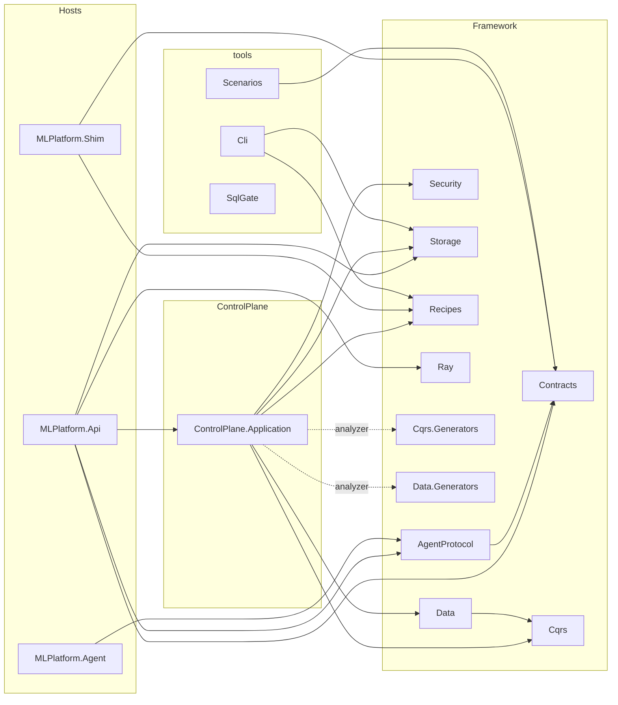
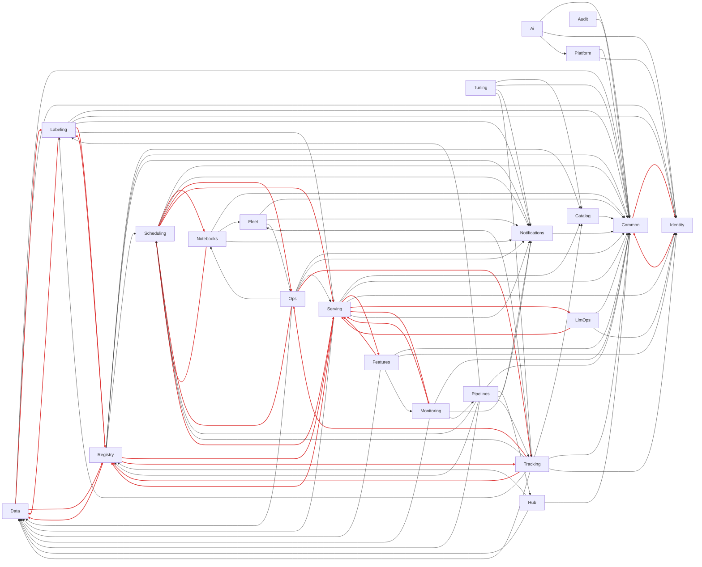
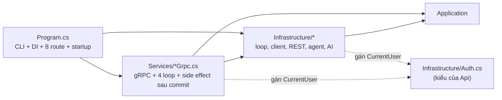
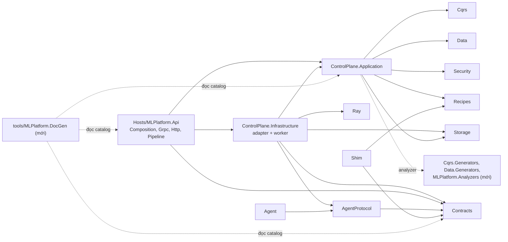
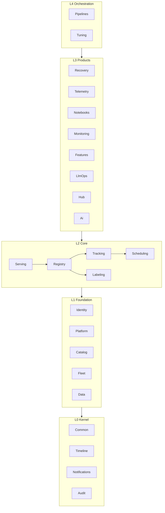

# MLPlatform backend — kế hoạch refactor

Trạng thái: **đã thực hiện xong Phase 0–7 (2026-11-22)**, xem mục "Kết quả" cuối file. Trước đó: **đã duyệt 2026-11-21** (chủ dự án đồng ý cả 6 câu ở mục 7). Đã xong: 0.0 (nâng .NET 11 / C# 15) và 0.1 (git). Hướng dẫn C# 15 cho mọi bước: skill `.claude/skills/csharp-15/SKILL.md`.
Ngày đo: 2026-11-21. Phạm vi: backend .NET 10 (`src/`, `tools/`), gate, docs sinh từ code, và trang API explorer ở `web/`.

Bản kế hoạch này đã qua ba reviewer độc lập, chỉ đọc code (kiến trúc; red-team vận hành kèm đối chiếu số liệu; UX). Mục 8 ghi lại những gì đã sửa theo góp ý và những điểm tôi tự kiểm lại trong code.

---

## 1. Số liệu hiện trạng

### 1.1 Theo project

| Project | File .cs | Dòng | Ghi chú |
|---|---:|---:|---|
| ControlPlane.Application | 64 | 12 295 | 1 061 type (16,6 type/file); 369 handler (206 command, 162 query); 491 method `[SqlQuery]` (482 tên khác nhau, 9 tên trùng giữa 2 module); 491 file `.sql` |
| Hosts/Api | 47 | 9 096 | 101 type; 24 service gRPC được host (proto có 25, `ModelServer` do Python `mlp_serve` phục vụ); 261 RPC trong proto; 13 route REST |
| Hosts/Shim | 9 | 2 036 | `Runner.cs` 582 dòng, chỉ 1 class |
| Hosts/Agent | 12 | 1 161 | |
| Framework (10 project) | 16 | 1 579 | gọn gàng; `Contracts` chỉ chứa proto |
| tools/Scenarios | 1 | 1 164 | toàn bộ nằm trong một `Program.cs` |
| tools/SqlGate, Cli | 2 | 132 | |
| **Tổng** | **151** | **27 463** | |

### 1.2 Các file lớn nhất

| File | Dòng | KB | Số type |
|---|---:|---:|---:|
| tools/MLPlatform.Scenarios/Program.cs | 1 164 | 90 | top-level |
| Api/Infrastructure/AiRuntime.cs | 709 | 42 | 19 |
| Application/Labeling/LabelHandlers.cs | 638 | 40 | 51 |
| Application/Pipelines/Pipelines.cs | 631 | 39 | 28 (`AdvancePipelineRunCommandHandler` ≈ 260 dòng) |
| Shim/Runner.cs | 582 | 35 | 1 |
| Api/Infrastructure/Scheduler.cs | 576 | 38 | 6 (`WorkloadLauncher` ≈ 300 dòng) |
| Api/Services/LabelingGrpc.cs | 519 | 34 | 3 |
| Application/Tracking/TrackHandlers.cs | 511 | 31 | 43 |
| Api/Infrastructure/LabelProposer.cs | 447 | 28 | 7 |
| Application/LlmOps/LlmOps.cs | 430 | 29 | 40 |
| Api/Infrastructure/HuggingFace.cs | 426 | 26 | 6 |
| Application/Features/Features.cs | 413 | 28 | 37 |
| Application/Tracking/RecipeCanvas.cs | 410 | 30 | 20 |
| Application/Ai/Ai.cs | 397 | 28 | 46 |
| Application/Monitoring/Monitoring.cs | 391 | 24 | 26 |

Nhiều dòng rất dài (tối đa 286–370 ký tự), nên số dòng ở trên thấp hơn kích thước thật của code.

### 1.3 Comment

| Loại | Dòng |
|---|---:|
| XML doc `///` | 1 304 (Application 793, Api 273, Shim 101, Agent 62, Framework 75) |
| Comment `//` đứng riêng một dòng | 301 |
| Comment ở cuối dòng code | 106 |
| Comment khối `/* */` | 15 |
| Tham chiếu spec trong comment (`D-xx`, `M03 §5`, `20/02 §4`) | 268 |

Gate hiện tại không hợp luật comment mới (mục 4.0). `MLPDOC001` (`tools/MLPlatform.SqlGate/Program.cs:77`) bắt mọi type public trong `src/ControlPlane` và `src/Hosts` phải có `/// <summary>`. `gates/baseline.txt` có 546 dòng, trong đó 461 dòng là `MLPDOC001`. Baseline này **khoá theo đường dẫn file**, nên chỉ cần di chuyển file là vi phạm cũ hiện lại thành vi phạm mới.

### 1.4 Bề mặt API, phân quyền, DB

**gRPC.** 24 service được host. Web gọi qua gRPC-Web (`@connectrpc/connect-web`, `@bufbuild/protobuf` v2, code sinh ở `web/src/gen`). Có 2 RPC server-streaming: `WatchWorkspace` và `WatchNotifications`.

**REST — 13 route:**
- `Program.cs` (8 route): `/nb/{id}/**`, `/mcp` POST và GET, `/health/live`, `/health/ready`, `/overlay/peers`, `/install/agent.sh`, `/install/agent.ps1`.
- `Infrastructure/Gateway.cs` (2 route): `/v1/deployments/{ws}/{slug}/predict|feedback`. Chỉ nhận header `Bearer mlpd_…`.
- `Infrastructure/AgentBuilds.cs` (3 route): `/install/agent/build…`.
- Ngoài ra có `PublicRoutes`, một middleware định tuyến theo subdomain.

**Phân quyền.**
- Có 177 lời gọi `WorkspaceAuthorizer.RequireAsync(ws, "perm")` dùng chuỗi literal, nằm trong thân handler. Trong 234/328 handler async, lệnh kiểm quyền là lệnh `await` đầu tiên. Khoảng 93 handler không kiểm quyền workspace.
- Có các ca động:
  - `Environments.cs:180`: tên quyền lấy từ request.
  - `Hub.cs:127`: quyền phụ thuộc `c.Kind`.
  - `Ai.cs:351`: workspace có thể không có.
  - 9 chỗ gọi `HasAsync` để mở rộng phạm vi xem.
  - `LabelAccess` kiểm theo project.
  - `TrackHandlers.cs:249` kiểm theo workspace của chính entity.
- `RequiresPermissionAttribute` (`Cqrs/Abstractions.cs:39`) và catalog `Generated.Requests` mà `CqrsGenerator` sinh ra **đã có nhưng chưa request nào dùng**.

**DB.** 21 schema, 89 lệnh `CREATE TABLE` trong `db/<schema>/*.sql`. Thư mục `Application/Sql/<x>` được đặt tên theo schema DB (`track`, `sched`, `nb`, …). Gate `MLPSQL020` dựa vào tên thư mục này để kiểm ranh giới module.

### 1.5 Đồ thị phụ thuộc

Ở cấp project, phụ thuộc là một DAG, tương đối sạch. Chỗ rối nằm **bên trong** hai project lớn.

**Application.** Đo bằng `using`, tên đầy đủ, tên tương đối (`Labeling.LabelSql`) và lời gọi tới method SQL của module khác (bỏ qua 9 tên trùng):
- 22 module, 94 cạnh phụ thuộc.
- **14 module** dính trong một thành phần liên thông mạnh (một vòng lớn); thêm vòng riêng Common↔Identity.
- 13 cặp phụ thuộc hai chiều.
- 110 lời gọi thẳng vào method SQL của module khác (118 nếu tính cả tên trùng).

**Api.**
- `Services/*Grpc.cs` chứa luôn 4 background loop (`MonitorLoop`, `PipelineLoop`, `FeatureLoop`, `SweepLoop`). `RuntimeGrpc` nằm chung file `SchedulerGrpc.cs`.
- `Infrastructure/` trộn REST endpoint, client gọi ra ngoài, loop, agent channel và AI runtime.
- Lớp gRPC tự làm side effect sau khi commit, ví dụ `StopRun` gọi `launcher.StopJobAsync` (`TrackingGrpc.cs:99`).
- `Program.cs` (265 dòng) trộn lệnh CLI, đăng ký DI, route và các startup task.
- 4 nơi giả danh người dùng bằng cách gán thẳng kiểu `CurrentUser` của Api: `PipelineGrpc.cs:99`, `TuningGrpc.cs:83`, `EvaluationRunner.cs:45`, `HuggingFace.cs:281`.

#### Hiện trạng — project



#### Hiện trạng — module trong Application (cạnh đỏ = phụ thuộc hai chiều)



Số cạnh ra (out) và vào (in) của từng module:

| Module | out | in |
|---|---:|---:|
| Ai | 3 | 0 |
| Audit | 1 | 0 |
| Catalog | 1 | 4 |
| Common | 1 | 21 |
| Data | 4 | 9 |
| Features | 5 | 1 |
| Fleet | 3 | 2 |
| Hub | 3 | 1 |
| Identity | 1 | 9 |
| Labeling | 6 | 4 |
| LlmOps | 3 | 1 |
| Monitoring | 5 | 2 |
| Notebooks | 4 | 2 |
| Notifications | 1 | 10 |
| Ops | 7 | 3 |
| Pipelines | 8 | 1 |
| Platform | 2 | 1 |
| Registry | 8 | 6 |
| Scheduling | 5 | 6 |
| Serving | 10 | 7 |
| Tracking | 9 | 4 |
| Tuning | 4 | 0 |

Các cặp hai chiều:
- Common↔Identity
- Data↔Labeling
- Data↔Registry
- Labeling↔Registry
- Registry↔Serving
- Registry↔Tracking
- Scheduling↔Serving
- Notebooks↔Scheduling
- Ops↔Scheduling
- Ops↔Tracking
- Features↔Serving
- LlmOps↔Serving
- Monitoring↔Serving

#### Hiện trạng — bên trong Api



---

## 2. Phân tích từng node

### 2.1 Framework

| Node | Trách nhiệm | Vấn đề | Đích |
|---|---|---|---|
| Cqrs | mediator, behavior, attribute | `RequiresPermissionAttribute` chưa dùng | giữ; thêm hàng đợi chạy sau khi commit (P4) |
| Cqrs.Generators | sinh đăng ký handler, mediator, catalog `Requests` | catalog dùng tên ngắn (`CqrsGenerator.cs:134`); `Collect` chỉ lấy interface handler đầu tiên (`:47-71`); handler trùng request bị bỏ im lặng | đổi sang tên đầy đủ; báo lỗi khi trùng; thêm mức truy cập vào catalog (P6) |
| Data / Data.Generators | session đọc và ghi; `[SqlQuery]` → ADO.NET; tìm `.sql` theo hậu tố đường dẫn bằng `FirstOrDefault` | khớp nhiều file thì im lặng; 9 tên method trùng gây lỗi CS0121 khi một file `using` cả hai module | báo lỗi khi khớp nhiều file; đổi tên 9 method trùng (P1) |
| Security, Storage, Recipes, Ray, AgentProtocol, Contracts | nhỏ, mỗi project một việc | `SecretBox` đang nằm trong `Api/Infrastructure/HuggingFace.cs` | giữ; chuyển `SecretBox` sang Security |

### 2.2 ControlPlane.Application, theo module

| Module | File / dòng / type | Vấn đề chính | Đích |
|---|---|---|---|
| Common | 3 / 116 / 7 | tra role thành viên qua SQL của Identity → vòng Common↔Identity (`Authorization.cs:40`) | Kernel; chuyển truy vấn role vào `Common/Access` |
| Audit, Notifications | 1 / 100 / 6; 1 / 194 / 22 | Notifications có fan-in 10 | Kernel |
| Ops | 5 / 907 / 96 | tên `Ops` và `Ops2` không nói gì; `OpsEvents` bị 6 module gọi; dữ liệu attempt (`Workload.ResolveAsync`, `HostAttemptJobsAsync`) được Tracking và Scheduling dùng | tách thành `Timeline` (Kernel: dòng sự kiện của job và attempt); dữ liệu attempt → `Scheduling`; `Recovery` (progress, heartbeat, checkpoint, suspect, resume); `Telemetry` (metric của host, anomaly, cluster map, incident); `DataSyncs` → `Data` |
| Identity, Platform | 6 / 601 / 65; 1 / 84 / 13 | | Foundation |
| Catalog, Fleet | 3 / 475 / 34; 5 / 410 / 53 | Fleet→Ops chỉ để ghi sự kiện | Foundation; hết vòng khi có `Timeline` |
| Data | 6 / 799 / 68 | gọi ngược lên Labeling và Registry để ghép dữ liệu đọc (`Browse.cs:97,117`) | Foundation; chuyển truy vấn ghép về module sở hữu dữ liệu |
| Scheduling | 3 / 461 / 46 | chép trạng thái chờ vào bảng của Serving và Notebooks (`SchedHandlers.cs:127-130`) | Core; Serving và Notebooks tự đọc trạng thái job khi truy vấn |
| Labeling | 7 / 1 685 / 163 | file 638 dòng, 51 type; 26 lời gọi SQL của Data; gọi Serving (`Assist.cs:315`) | Core |
| Tracking | 7 / 1 529 / 110 | out-degree 9; chặn xoá run qua Registry (`TrackHandlers.cs:400`) | Core; dùng port "veto" do Registry cài |
| Registry | 6 / 1 474 / 82 | 4 cặp hai chiều | Core, đứng trên Tracking, Labeling, Data |
| Serving | 2 / 410 / 44 | out-degree 10; dọn dữ liệu của Features, Monitoring, LlmOps khi xoá deployment | Core, đứng trên Registry; dọn dữ liệu bằng sự kiện fan-out |
| Notebooks, Monitoring, Features, LlmOps, Hub, Ai | mỗi module 1 file (188–413 dòng) | một file chứa SQL, row, logic, mọi handler | Products |
| Pipelines, Tuning | 1 file mỗi module (631, 264 dòng) | điều phối gần như mọi module (`Pipelines.cs:424-578`) | Orchestration (tầng trên cùng) |
| `Sql/` | 491 file trong 21 thư mục đặt theo tên schema | tên thư mục khác tên module; truy vấn của Data nằm cả trong `Sql/Label`, `Sql/Registry`, `Sql/Track` | **giữ tên theo schema** (MLPSQL020 cần); `modules.json` ghi ánh xạ module → thư mục SQL |

### 2.3 Hosts/Api

| Folder | Nội dung | Vấn đề | Đích |
|---|---|---|---|
| `Program.cs` | lệnh CLI `probe` và `db apply`, 80 dòng DI, OTel, 24 `MapGrpcService`, 8 route REST, 5 startup task | mọi thứ dồn một chỗ | `Program.cs` ≈ 30 dòng; tách ra `Composition/`, `Commands/`, `Startup/`, `Grpc/`, `Http/` |
| `Services/` | 21 file, 24 service; mapper `ToProto` trộn trong service; helper `G()` lặp lại ở nhiều file | 4 loop và `RuntimeGrpc` lẫn vào; `IamServices.cs` chứa 3 service; side effect sau commit nằm ở lớp gRPC | `Api/Grpc/<Service>/`; side effect chuyển sang hàng đợi sau commit (P4) |
| `Infrastructure/` | 25 file | trộn API với phần không phải API; `Notebooks.cs` và `AgentBuilds.cs` trộn code HTTP với code nền | code nền → project `ControlPlane.Infrastructure`; REST → `Api/Http/<Area>/`; auth và xử lý lỗi → `Api/Pipeline/` |

### 2.4 Hosts/Agent, Hosts/Shim, tools

- **Agent:** cấu trúc ổn. Tách `CommandHandler.cs` (217 dòng) theo từng lệnh.
- **Shim:** tách `Runner.cs` theo giai đoạn: chuẩn bị, tải dữ liệu, chạy, upload, recovery.
- **Scenarios:** mỗi module một file scenario, cộng `ScenarioRunner`. Thêm scenario ma trận quyền (P6).
- **SqlGate:** đổi tên thành `CodeGate`, sửa baseline (P0). Các rule kiến trúc chuyển sang Roslyn analyzer.

---

## 3. Kiến trúc đích

Kiểu kiến trúc: **modular monolith + CQRS theo vertical slice** (handler chứa logic nghiệp vụ, dữ liệu là record lấy thẳng từ SQL). **Không phải DDD**: không có aggregate, entity, value object hay repository. "Module" chỉ là ranh giới sở hữu schema và code; "interface" ở module dưới là điểm mở rộng để module trên cắm vào.

### 3.1 Project



**Luật phụ thuộc:**
- Chiều phụ thuộc: Api → Infrastructure → Application → Framework.
- Infrastructure không được biết tới Api.
- Application không dùng ASP.NET, Npgsql thô hay HTTP client. Luật này được ép bằng `BannedSymbols.txt`, vốn đã có trong `Directory.Build.props`.

**Application vẫn là một assembly.** Lý do: `CqrsGenerator` sinh một mediator cho mỗi assembly (`CqrsGenerator.cs:90-98`), và thêm project thì build tốn CPU hơn. Ranh giới module được ép bằng Roslyn analyzer có semantic model, chạy ngay trong build. Không dùng regex: method SQL là extension `public static` trên `IReadSession`, nên chỉ đọc symbol mới biết lời gọi thuộc module nào.

### 3.2 Tầng module trong Application



**Luật tầng:**
- Chỉ được phụ thuộc xuống tầng dưới.
- Phụ thuộc giữa hai module cùng tầng phải khai báo trong `modules.json` và không được tạo vòng. Ví dụ ở L2: Serving → Registry → Tracking → Scheduling, Registry → Labeling, Labeling → Serving (Assist). Cạnh cuối cần quyết khi làm (P4).
- Method `[SqlQuery]` thuộc riêng module của nó. Module khác chỉ được dùng Command/Query của module đó, hoặc các method gắn `[ModuleApi]`. Danh sách `[ModuleApi]` này cũng xuất hiện trong docs.
- Không dùng event trong transaction làm cách mặc định. Gặp phụ thuộc "ngược lên" thì xử lý theo thứ tự ưu tiên ở mục 4, Phase 4.

### 3.3 Bố cục file trong một module

```
Application/<Module>/
  <Area>/<UseCase>.cs           request + handler + các type chỉ slice này dùng
  Domain/<Type>.cs              logic thuần (PipelineDefinition, Guardrails, EvalMath…)
  Persistence/<Module>Sql.cs    partial class [SqlQuery]; tách partial theo nhóm bảng nếu > 200 dòng
  Persistence/<Row>.cs          row dùng chung cho nhiều slice
  Interfaces/I<Name>.cs         interface do Infrastructure hoặc module trên cài đặt
```

- Namespace đặt theo module (`MLPlatform.ControlPlane.Application.LlmOps`), không thêm cấp theo thư mục con.
- Không dùng `global using` cho module: global using có hiệu lực toàn assembly, sẽ xoá ranh giới module và gây CS0121.
- Giới hạn mềm, CodeGate cảnh báo khi vượt: file ≤ 200 dòng, method ≤ 40 dòng, dòng ≤ 160 ký tự.

Ví dụ `LlmOps/LlmOps.cs` (430 dòng, 40 type) sau khi tách:

```
LlmOps/
  Persistence/LlmSql.cs, PromptRow.cs, PromptVersionRow.cs, EvalSetRow.cs, EvalRunRow.cs
  Interfaces/ILlmInvoker.cs
  Domain/Guardrails.cs, PromptTemplate.cs, LlmCall.cs
  Prompts/CreatePrompt.cs, ListPrompts.cs, GetPrompt.cs, CreatePromptVersion.cs, RunPrompt.cs, PromptLookup.cs
  Settings/GetLlmSettings.cs, UpdateLlmSettings.cs
  Chat/GatewayChat.cs
  Usage/GetLlmUsage.cs
  Evals/CreateEvalSet.cs, ListEvalSets.cs, RunEval.cs, ListEvalRuns.cs
```

Ước lượng: Application đi từ 64 file lên khoảng 450–550 file, trung bình 25–40 dòng mỗi file.

### 3.4 Api đích

```
src/Hosts/MLPlatform.Api/
  Program.cs
  Composition/   ApiServices.cs, Telemetry.cs, ConfigurationOptions.cs
  Commands/      ProbeCommand.cs, DbApplyCommand.cs, DescribeCommand.cs
  Startup/       IStartupTask.cs, EnsureConfiguredAdmin.cs, RearmAfterRestart.cs,
                 IssueBootstrapToken.cs, EnsureBuckets.cs, SyncBuiltinRecipes.cs
  Pipeline/      AuthMiddleware.cs, PublicRoutesMiddleware.cs, ErrorInterceptor.cs
  Grpc/          GrpcApi.cs (MapGrpcApi)
                 Shared/RequestIds.cs, ProtoTime.cs
                 <Service>/<Service>GrpcService.cs, <Service>ProtoMapping.cs   (24 thư mục)
  Http/          HttpApi.cs (MapHttpApi)
                 Inference/PredictEndpoint.cs, FeedbackEndpoint.cs
                 Mcp/McpEndpoints.cs, McpServer.cs
                 Install/InstallScriptEndpoints.cs, AgentBuildEndpoints.cs
                 Health/HealthEndpoints.cs
                 Overlay/OverlayPeersEndpoint.cs
                 Notebooks/NotebookProxyEndpoint.cs, NotebookProxy.cs
                 OpenApi/OpenApiDocumentEndpoint.cs
```

- Tên route và tên RPC giữ nguyên 100%, vì agent đã cài, client gateway và web đều đang dùng.
- Startup task vẫn chạy trước `app.Run()` và theo đúng thứ tự hiện tại. `RearmAfterRestart` phải chạy trước các loop.
- Hosted service giữ nguyên thứ tự đăng ký.

### 3.5 ControlPlane.Infrastructure (project mới)

```
src/ControlPlane/MLPlatform.ControlPlane.Infrastructure/
  InfrastructureServices.cs   (AddControlPlaneInfrastructure)
  Agents/        AgentListener, AgentRegistry, AgentSession, CommandTrace, DataChannelBroker,
                 AgentUpgrader, AgentBuildStore, HostContainers
  Scheduling/    SchedulerLoop, ReservationKeeper, WorkloadLauncher, RecipeEnvironments, SweepLoop, ErrorHeadline
  Recovery/      RecoveryLoop
  Serving/       DeploymentProber, ModelServerClients, ModelServerLlmInvoker, EvaluationRunner
  Ai/            AiRuntime, AiProviders, AiCircuits, AiLimiter, AiRecoveryLoop
  Labeling/      LabelProposer, PrelabelLoop, ItemContent, HermesLabelChecker, HermesQuality
  Hub/           HfHub, HubImporter
  Messaging/     EmailSender, SmtpTransport, TelegramSender
  Notebooks/     NotebookReaper
  Data/          DataCacheJanitor
  Observability/ LogStore, SystemHealth, HealthLoop, StreamBroker
  Settings/      DynamicSettings
  Workers/       MonitorLoop, PipelineLoop, FeatureLoop
  Overlay/       OverlayPeerSync
```

Project này chỉ cần `Microsoft.Extensions.Hosting` và `Http`, cùng kiểu client `Grpc.Core` lấy qua Contracts. Không cần ASP.NET, với điều kiện hai file `Notebooks.cs` và `AgentBuilds.cs` được tách trước, và chỗ giả danh người dùng chuyển vào Application (bước 1.2).

---

## 4. Kế hoạch theo phase

### 4.0 Luật chung

**Thứ tự.** Giữ thứ tự chủ dự án đưa ra: phân tầng → tách file → thư mục API → dọn comment → OpenAPI/docs → explorer. Có một chỗ lệch, cần chủ dự án duyệt:
- Phần **cấu trúc** của phân tầng làm đầu tiên (Phase 1): project mới, nơi giữ người dùng hiện tại, Kernel, manifest, analyzer ở chế độ báo cáo.
- Phần **đổi logic** để gỡ vòng giữa các module làm ở Phase 4, sau khi đã tách file và gom thư mục API. Lý do: lúc đó chuyển một slice sang module khác chỉ còn là di chuyển một file nhỏ, và mỗi file không phải sửa hai, ba lần.
- Phần đọc hiểu (trích method, đổi tên) gộp với dọn comment thành một phase (Phase 5).

**Luật comment (chủ dự án chốt 2026-11-21, thay cho luật "không comment"):**
- **Trong thân hàm: không có comment nào.** Thân method, constructor, accessor, lambda, local function, kể cả comment cuối dòng. Ý cần giải thích → tên biến, tên method trích ra, hằng có tên.
- **Ở khai báo (type, member): được phép, ngắn.** Một câu, tối đa 2 dòng, mỗi dòng ≤ 120 ký tự, tiếng Anh. Nói *cái gì / vì sao*, không kể *làm thế nào*. Không `<remarks>`, không đoạn văn.
- **Không bắt buộc** có comment: type/member tự rõ nghĩa thì không cần.
- Gate: `MLPCODE001` (comment trong thân hàm = lỗi) và `MLPCODE003` (comment khai báo quá 2 dòng hoặc quá 120 ký tự/dòng = lỗi). `MLPDOC001` (bắt buộc `/// <summary>`) bỏ hẳn.

**Kiểm chứng mỗi bước:**
- Build: `MSBUILDDISABLENODEREUSE=1 nice -n 19 dotnet build MLPlatform.slnx -m:1 -warnaserror`.
- CodeGate.
- `buf breaking`: proto không đổi.
- So snapshot bề mặt (`mlp-api describe`): phải giống hệt bản trước, trừ những thay đổi đã khai trong bước.
- Mỗi bước là một commit.

**Kiểm chứng ở cuối mỗi phase (mốc):**
- `gates/run.sh --aot`: chạy nền, `nice`, khoảng 5–10 phút trên một core.
- Toàn bộ scenario trên **stack kiểm chứng riêng** (bước 0.2).
- Build lại image `api` của stack dev mất 10–15 phút (AOT), nên **hỏi chủ dự án trước** mỗi lần. Lệnh: `docker compose --project-directory deploy/compose -f compose.yaml -f compose.dev.yaml build api`, rồi `… up -d --no-deps api`. Không bao giờ chạy compose thiếu `compose.dev.yaml`.
- Sau đó đăng nhập (tài khoản lấy từ `.env`) và đi một luồng thật trên web.

**Không đụng tới stack dev đang chạy:**
- Không chạy `deploy/dev/stack.sh up|test|down` khi stack dev đang chạy. Các lệnh này xoá container `api`, `web`, `wireguard`, `mlp-ray-head` của compose project `mlplatform`.
- Stack dev ghi vào **DB thật ở xa**: `MLP_DB_CONNECTION` trỏ tới 45.119.212.162.

**Máy:**
- Không chạy song song hai việc nặng.
- Tối đa một subagent làm việc nặng tại một thời điểm.
- Kiểm tải bằng `pmset -g therm` giữa các bước.
- Dừng mọi container và server đã bật khi xong.

### Phase 0 — Lưới an toàn (S)

| Bước | Phạm vi | Cách làm | Rủi ro | Kiểm chứng |
|---|---|---|---|---|
| 0.0 ✅ | toàn repo | **Nâng .NET 10 → .NET 11 (SDK 11.0.100 GA), C# 15** (`LangVersion 15.0`): `global.json`, `Directory.Build.props`, gói (gRPC 2.85, Npgsql 11, OpenTelemetry 1.21, Microsoft.Extensions 11), bỏ 4 tham chiếu `*.Abstractions` (NU1510: đã có trong framework), bỏ `NuGetAuditSuppress` của SDK 10, Dockerfile `sdk:11.0` + `runtime-deps:11.0-resolute-chiseled`, CI, script. | breaking change .NET 11 (skill mục 10) | build `-warnaserror` 0 lỗi 0 cảnh báo; `buf lint/breaking`; AOT publish api |
| 0.1 ✅ | toàn repo | **Repo chưa có git.** Điều kiện tiên quyết là `git init`, kiểm `.gitignore` (`.env`, `.dev/`, `bin/`, `obj/`), commit nền, rồi mỗi bước một commit. Cần chủ dự án đồng ý. | không có cách hoàn tác thật | `git status` sạch |
| 0.2 ✅ | `deploy/verify` | stack kiểm chứng riêng: compose project `mlp-verify`, port, volume và tên container riêng, Postgres, S3 và Ray cục bộ, api chạy từ source ở port riêng. `stack.sh` nhận `MLP_VERIFY=1` để không bao giờ chạm project `mlplatform`. | xung đột port với `mlp-wg-dev` (5080/5081/7443) | chạy scenario khi stack dev vẫn chạy, rồi `docker ps` cho thấy container dev không đổi |
| 0.3 ✅ | `Api/Commands/SurfaceDescription.cs`, `gates/surface.sh` | lệnh `mlp-api describe --json`: dựng host với config giả, không chạy server và **không chạy startup task**. Xuất method gRPC, route REST kèm verb và metadata, danh sách DI theo thứ tự, hosted service theo thứ tự, catalog `Requests`. | | `artifacts/surface/baseline.json` |
| 0.4 ✅ | `tools/MLPlatform.CodeGate`, `gates/` | đổi tên thành CodeGate. **Tắt MLPDOC001 ngay** (cần chủ dự án đồng ý, vì đi ngược luật "không thêm baseline"). Khoá baseline của các rule còn lại theo symbol hoặc tên query thay vì đường dẫn file. Thêm `--metrics` để tái tạo các bảng ở mục 1. | | số liệu khớp mục 1 |
| 0.5 ✅ | 151 file .cs → `artifacts/refactor/comment-inventory.csv` | xuất kho comment `artifacts/refactor/comment-inventory.csv` (file, symbol, loại, nội dung, tham chiếu spec) **trước khi di chuyển bất cứ thứ gì**, để giữ tri thức | | đủ 1 304 + 301 + 106 + 15 dòng |
| 0.6 | — | ghi lại trạng thái nền trên stack kiểm chứng: gate xanh, số scenario pass, một lần AOT publish | | `artifacts/baseline/` |

### Phase 1 — Phân tầng: cấu trúc (M)

| Bước | Phạm vi | Cách làm | Rủi ro | Kiểm chứng |
|---|---|---|---|---|
| 1.1 ✅ | `Application/modules.json`, project mới `src/Framework/MLPlatform.Analyzers` | manifest: module → tầng, các cạnh cùng tầng được phép, thư mục SQL/schema, file spec trong cookbook. Analyzer `MLPARCH001` (cạnh cấm) và `MLPARCH002` (SQL của module khác) chạy dưới dạng cảnh báo có baseline. Ban ASP.NET và Npgsql thô trong Application. | analyzer làm build chậm | analyzer liệt kê đúng 13 cặp hai chiều ở 1.5 |
| 1.2 ✅ | `Common`, `Api/Infrastructure/Auth.cs`, 4 chỗ giả danh | đưa nơi giữ người dùng hiện tại vào Application: `IUserScopes.RunAsAsync(userId, …)`; `CurrentUser` đứng sau interface đó. Sửa `PipelineGrpc.cs:99`, `TuningGrpc.cs:83`, `EvaluationRunner.cs:45`, `HuggingFace.cs:281`. | đổi cách loop chạy dưới danh nghĩa người tạo | scenario sweep, pipeline, eval, import HF |
| 1.3 ✅ | `Notebooks.cs`, `AgentBuilds.cs`, `HuggingFace.cs`, `Services/*Grpc.cs` | tách các file trộn trước khi chuyển: `NotebookProxy` / `DataChannelBroker` / `NotebookReaper`; endpoint / `AgentBuildStore`; `SecretBox` → Security; 4 loop và `RuntimeGrpc` ra khỏi file gRPC | ít | snapshot giống hệt |
| 1.4 ✅ | project mới `ControlPlane.Infrastructure` | chuyển nguyên file (sau 1.3); thêm `AddControlPlaneInfrastructure(cfg)` và giữ thứ tự đăng ký hosted service. `Buckets` đang là static bị gán từ `Program.cs` → options `StorageBuckets` (đây là thay đổi logic nhỏ, có khai báo). | mất đăng ký DI | snapshot DI và hosted service giống hệt |
| 1.5 ✅ | `Common`, `Identity`, `Ops`, SQL | sửa Kernel một cách máy móc: truy vấn role → `Common/Access` (hết vòng Common↔Identity); `OpsEvents` + `ListEvents` + `JobWorkspace` → module `Timeline` (hết vòng Fleet→Ops và một phần Scheduling↔Ops); đổi tên 9 method SQL trùng (`InsertProjectAsync`, `GetProjectAsync`, `ListProjectsAsync`, `ProjectStatsAsync`, `InsertRunAsync`, `InsertEventAsync`, `ListEventsAsync`, `InsertTrialAsync`, `DeleteDeploymentDataAsync`) theo module | đổi namespace ở các chỗ gọi | build; analyzer bớt cạnh |

### Phase 2 — Tách file (L)

| Bước | Phạm vi | Cách làm | Rủi ro | Kiểm chứng |
|---|---|---|---|---|
| 2.0 ✅ | `tools/MLPlatform.Refactor` (tạm, xoá sau Phase 5) | tool Roslyn chỉ làm việc ở mức cú pháp, không dùng MSBuildWorkspace vì nặng. Lệnh `inventory` đề xuất ánh xạ type → file đích (CSV để duyệt). Lệnh `split --map` cắt type/slice giữ nguyên từng byte và chép `using` của file gốc. | tool lỗi | chạy thử trên Audit và Platform |
| 2.1 ✅ | Kernel và Foundation | tách theo 3.3, **trong thư mục module hiện tại**; type chỉ một slice dùng thì nằm trong file của slice đó | ít | build + snapshot |
| 2.2 ✅ | Scheduling, Serving, Registry | như trên | ít | build + snapshot |
| 2.3 ✅ | Tracking, Labeling (hai module lớn nhất) | như trên | ít | build + snapshot |
| 2.4 ✅ | Ops (tách thành `Recovery`, `Telemetry`; dữ liệu attempt → Scheduling), Notebooks, Monitoring, Features, LlmOps, Hub, Ai, Pipelines, Tuning | như trên; tên `Ops`/`Ops2` biến mất | ít | build + snapshot + scenario |
| 2.5 ✅ | ControlPlane.Infrastructure | một type một file (`Scheduler.cs`, `AiRuntime.cs`, `HuggingFace.cs`, `LabelProposer.cs`, `Observability.cs`, `Email.cs`, `AgentListener.cs`, …) | ít | snapshot DI |
| 2.6 | Agent, Shim, Scenarios | `CommandHandler.cs`, `Runner.cs` (chỉ di chuyển); `Scenarios/Program.cs` → mỗi module một file | ít | scenario |
| 2.7 | toàn bộ | dọn `using` thừa một lần (`dotnet format` chỉ với IDE0005, `nice`). CodeGate `MLPCODE002` (mỗi file một type top-level hoặc một slice) chuyển thành lỗi cứng. | | gate xanh |

### Phase 3 — Thư mục API (M)

| Bước | Phạm vi | Cách làm | Rủi ro | Kiểm chứng |
|---|---|---|---|---|
| 3.1 ✅ | `Api/Services/*` | chuyển sang `Api/Grpc/<Service>/`; mapper `ToProto` → `<Service>ProtoMapping.cs`; helper `G()` → `Grpc/Shared/RequestIds.cs`; tách `IamServices.cs` và `SchedulerGrpc.cs` theo service | ít | snapshot gRPC giống hệt |
| 3.2 ✅ | REST trong `Program.cs`, `Gateway.cs`, `AgentBuildEndpoints`, `McpServer.cs`, `NotebookProxy` | chuyển sang `Api/Http/<Area>/`; mỗi area một `MapGroup` có `WithName`, `WithTags`, `Produces`, `Accepts` | thứ tự middleware | snapshot route giống hệt; gọi thử `/health/ready`, predict thật, `/install/agent.sh` |
| 3.3 ✅ | `Program.cs` | tách ra `Composition/`, `Commands/`, `Startup/`; `IStartupTask` chạy tuần tự trước `app.Run()` | thứ tự khởi động | log khởi động giống bản trước |
| 3.4 ✅ | Analyzer | `MLPAPI001`: `Map*` và `MapGrpcService` chỉ được gọi trong `Api/Grpc` và `Api/Http`; class `*GrpcService` chỉ được nằm trong `Api/Grpc` | | build xanh |

Ghi chú thực hiện Phase 1–3 (2026-11-22):
- Luật kiến trúc (`MLPARCH001/002`), bố cục file (`MLPCODE002`) và vị trí API (`MLPAPI001`) nằm trong CodeGate (Roslyn cú pháp + `modules.json`), không phải analyzer trong build: nhanh hơn và có baseline theo symbol.
- `Api/Pipeline` đổi thành `Api/Middleware` vì trùng tên message proto `Pipeline`.
- Sửa thêm lỗi có từ trước: agent gắn nhãn `mlp.agent` cho container của mình (hai agent chung Docker daemon không còn báo nhầm container của nhau).
- Còn lại của Phase 2: 2.6 (tách `Scenarios/Program.cs`), 2.7 (dọn `using` thừa).

### Phase 4 — Phân tầng: gỡ vòng module (L, đổi logic)

Khi gặp phụ thuộc "ngược lên", chọn cách xử lý theo thứ tự ưu tiên:
1. Chuyển truy vấn về module sở hữu dữ liệu.
2. Dùng ràng buộc DB (foreign key) hoặc một port "veto" khai ở tầng dưới.
3. Suy ra trạng thái bằng cách đọc/join thay vì chép vào bảng khác.
4. Chỉ dùng event khi thật sự là fan-out. Handler của event là code tin cậy, không phải request, và được gọi tường minh tại điểm phát.
5. Side effect ra ngoài hệ thống (launcher, agent) đưa vào **hàng đợi sau commit** trong `UnitOfWorkBehavior`, không nằm ở lớp gRPC.

| Bước | Cạnh | Cách dự kiến (xác nhận khi làm) | Rủi ro | Kiểm chứng |
|---|---|---|---|---|
| 4.1 ✅ | Cqrs | thêm hàng đợi sau commit (`IAfterCommit.Enqueue`), sinh tĩnh, an toàn với AOT. Chuyển các side effect như `StopRun`/`CancelTrial` → `launcher.StopJobAsync` từ `TrackingGrpc` sang hàng đợi này. | command lồng nhau dùng chung transaction (`Context.cs:34`): hàng đợi chỉ được xả ở lớp ngoài cùng | scenario stop/cancel |
| 4.2 ✅ | Data→Labeling, Data→Registry, Labeling→Registry | chuyển các truy vấn ghép (`Browse.cs:97,117`) về module ở tầng trên | trung bình | scenario dataset browse, label |
| 4.3 ✅ | Scheduling→Serving, Scheduling→Notebooks | Serving và Notebooks đọc lý do chờ từ job thay vì Scheduling ghi vào bảng của chúng (`SchedHandlers.cs:127-130`) | UI phải hiển thị giống hệt | scenario deploy/notebook chờ GPU; xem trên web |
| 4.4 ✅ | Tracking→Registry, Registry→Serving | interface chặn `IRunDeletionGuard` (Tracking khai báo, Registry cài đặt); phần Exports cần Serving chuyển lên Serving | trung bình | scenario xoá run, export |
| 4.5 ✅ | Serving→Features, Monitoring, LlmOps | dọn dữ liệu khi xoá deployment bằng event fan-out `DeploymentDeleted` | xoá thiếu dữ liệu | scenario xoá deployment rồi kiểm bảng |
| 4.6 ✅ | Monitoring→Pipelines | event `DriftDetected` | | scenario drift → pipeline |
| 4.7 ✅ | Analyzer | `MLPARCH001` và `MLPARCH002` chuyển thành lỗi cứng, baseline rỗng | | build xanh |

### Phase 5 — Đọc hiểu, dọn comment (M–L)

| Bước | Phạm vi | Cách làm | Rủi ro | Kiểm chứng |
|---|---|---|---|---|
| 5.1 ✅ | theo module, dựa trên kho comment ở 0.5 | **comment trong thân hàm** (301 dòng riêng + 106 cuối dòng, hầu hết nằm trong thân): (a) thừa → xoá; (b) giải thích "cái gì" → đổi tên, trích method, hằng có tên, type; (c) giải thích "tại sao" → tên method trích ra (ví dụ `ReholdReservationsLostByRayRestart`), hoặc một câu ngắn ở khai báo của method đó. **Comment khai báo** (1 304 dòng `///`): rút còn một câu ≤ 2 dòng, bỏ phần kể cách làm, bỏ `<remarks>`; xoá nếu tên đã nói đủ. Tham chiếu spec dài → trường `spec` của module trong `modules.json`; mã ngắn (`D-40`) giữ được trong câu khai báo. | mất tri thức | duyệt mẫu theo từng module |
| 5.2 ✅ | các method dài | trích method giữ nguyên hành vi: `AdvancePipelineRunCommandHandler` (~260 dòng), `WorkloadLauncher` (~300), `AiRuntime`, `Shim/Runner`, `HfHub`. Làm cùng lúc với 5.1, mỗi file chỉ động vào một lần. | trung bình | scenario |
| 5.4 ✅ | theo module, cùng lần chạm với 5.1–5.2 | áp dụng C# 15 theo checklist của skill `csharp-15` (mục 11): họ record trừu tượng nội bộ → `closed` (bỏ nhánh `_ => throw`); kết quả "một trong N" (tuple `(trial, job?)`, `ChatReply`/`DecisionReply`, bước pipeline) → `union` với case là record class; collection biết trước kích thước → `[with(capacity: n), ..]`; vòng lồng thoát bằng cờ/`goto` → `break`/`continue` có nhãn (IDE0410 bật mức lỗi); backing field chỉ để kiểm tra → `field`; nhóm extension → khối `extension` (kể cả extension indexer cho `JsonObject`/config). Không dùng tính năng preview (`unsafe(...)`, `safe`). | đổi chữ ký public | build + snapshot + scenario |
| 5.3 ✅ | toàn bộ C# viết tay | bật `MLPCODE001` (không comment trong thân hàm) và `MLPCODE003` (comment khai báo ≤ 2 dòng, ≤ 120 ký tự/dòng) ở mức lỗi, trừ `obj/` và file sinh. Giữ directive `#pragma`. Không đụng `.sql` (dòng `-- mlp:query` là cú pháp) và proto. | | build + gate xanh |

### Phase 5b — Hiệu năng (M, đo trước rồi mới sửa)

| Bước | Phạm vi | Cách làm | Rủi ro | Kiểm chứng |
|---|---|---|---|---|
| 5b.1 ✅ | `tools/MLPlatform.Benchmarks` (mới), stack kiểm chứng | đo nền: BenchmarkDotNet (chạy `nice`, một core) cho đường nóng — `SchedulerLoop.TickAsync` (chọn host), gateway predict (parse body, gọi model server, ghi prediction log), khung agent (`AgentProtocol/Framing`), hàng đợi label (`SKIP LOCKED`), `StreamBroker`, ánh xạ proto `ToProto`; thêm thời gian từng scenario, RSS và thời gian khởi động của api AOT | số đo nhiễu khi máy bận | lưu `artifacts/perf/baseline.json` |
| 5b.2 ✅ | `Directory.Build.props` | thử **runtime async** của .NET 11 (`<Features>runtime-async=on</Features>`): giảm chi phí async cho mọi handler và loop; giữ nếu AOT publish + scenario xanh và số đo không tệ hơn | hành vi stack trace/ExecutionContext | AOT + scenario + so 5b.1 |
| 5b.3 ✅ | đường nóng đo được ở 5b.1 | áp dụng API .NET 11 trong skill (mục 9): `FrozenDictionary` cho `Permissions` và catalog setting; `EqualityComparer<T>.Create`; `SearchValues`; `[LoggerMessage]`; `Utf8JsonWriter.Reset` cho writer dùng lại; `Base64.EncodeToUtf8`; `ReadOnlyMemoryStream` thay copy; `[with(capacity)]`; bỏ LINQ trong vòng lặp per-item của scheduler/gateway; union struct có `TryGetValue` khi case là value type | tối ưu sai chỗ | mỗi thay đổi kèm số đo trước/sau; bỏ nếu không nhanh hơn |
| 5b.4 | `HttpClient` | `SocketsHttpHandler.InitialHttp2MaxConcurrentStreams`/`ShouldEvictConnection` cho client model server và Ray; nén body lớn bằng `ZstandardCompressedContent` khi phía nhận hỗ trợ | tương thích phía nhận | scenario serving |
| 5b.5 | SQL | dùng số đo DB (`pg_stat_statements` trên stack kiểm chứng) cho các truy vấn nóng; thêm index/sửa truy vấn qua migration mới | migration | scenario + so số đo |

### Phase 6 — Quyền khai báo, OpenAPI, docs sinh từ code (L)

| Bước | Phạm vi | Cách làm | Rủi ro | Kiểm chứng |
|---|---|---|---|---|
| 6.0 ✅ | Scenarios | **trước khi đổi chỗ kiểm quyền:** thêm scenario ma trận quyền sinh tự động cho mọi RPC có workspace: người ngoài → `NOT_FOUND`, viewer làm thao tác ghi → `PERMISSION_DENIED`, chưa đăng nhập → `UNAUTHENTICATED`. Hiện scenario chỉ kiểm 1 lần `PERMISSION_DENIED` và chưa lần nào kiểm `NOT_FOUND`. | | chạy xanh trên code hiện tại |
| 6.1 ✅ | mọi Command/Query | mỗi request có đúng một attribute truy cập: `[RequiresPermission("x")]`, `[InstanceAdmin]`, `[Authenticated]`, `[Anonymous]`, `[Internal]`. `AuthorizationBehavior` đặt **bên trong** `AuditBehavior` để lần bị từ chối vẫn được audit. Cache role theo scope (tránh N+1 khi command lồng nhau). Các ca động (`Environments.cs:180`, `Hub.cs:127`, `Ai.cs:351`, `LabelAccess`, `TrackHandlers.cs:249`, các chỗ `HasAsync`) vẫn kiểm trong thân handler nhưng khai attribute đánh dấu `Dynamic`. `Guid?` WorkspaceId bằng null phải có nghĩa rõ ràng. Thiếu attribute → **lỗi do generator báo**. | đổi chỗ kiểm quyền | scenario 6.0 |
| 6.2 ✅ | generator | catalog `Requests` dùng tên đầy đủ, có mức truy cập, có module. Thêm generator trong Api sinh catalog RPC → request(s) (đọc lời tạo request trong từng override; RPC gọi nhiều request hoặc gọi Infrastructure được ghi đủ). | | snapshot catalog |
| 6.3 ✅ | OpenAPI | Api tự dựng `GET /openapi/v1.json` **lúc chạy**, từ các catalog sinh lúc compile cộng descriptor proto, viết bằng `Utf8JsonWriter` (an toàn với AOT, không thể lệch code). REST: path thật cùng `securitySchemes` (cookie, key người dùng `mlp_`, key deployment `mlpd_`); predict dùng `oneOf` theo task, có ví dụ. gRPC: mỗi RPC chỉ để **mô tả**, đánh dấu `x-grpc`, không gắn `servers`, không giả làm HTTP JSON (server không nhận JSON). Extension: `x-kind`, `x-effect` (read / write / delete / compute), `x-access`, `x-roles`, `x-check` (workspace / entity / dynamic), `x-audience` (user / agent / internal), `x-streaming`, `x-scope-field`, `x-ref` cho mỗi field id (entity, RPC liệt kê, field hiển thị, route trong app), `x-errors`, `x-test-op`, `x-mcp-tool`; `info.x-proto-hash`. | | so với catalog; AOT publish |
| 6.4 ✅ | `tools/MLPlatform.DocGen` (mới) | đọc: catalog đã biên dịch, file `buf build` image **có source info** (comment proto được đưa vào docs, không đưa lên UI), migration `db/**`, `Sql/**`. Sinh ra: `docs/generated/api/<service>.md` (RPC, request, response, quyền, role, handler, module); `docs/generated/rest.md`; `docs/generated/types/*.md` (field, kiểu, số thứ tự, enum); `docs/generated/db/<module>.md` (bảng, cột, kiểu, null, khoá, query nào đọc/ghi bảng); `docs/generated/modules.md` (tầng, sơ đồ mermaid **sinh từ code**, link spec) | parser migration chưa đủ cú pháp | `--verify-db` so với `information_schema` của **DB trên stack kiểm chứng** (không bao giờ DB thật) |
| 6.5 ✅ | build và gate | catalog sinh lúc compile (source generator). DocGen chạy trong `gates/run.sh` với `--check` (lỗi nếu file sinh ra khác bản commit) và qua target MSBuild **tuỳ chọn** `-p:GenerateDocs=true`. Không chạy trong Docker AOT publish (`.dockerignore` đã loại `cookbook`). | | gate |
| 6.6 ✅ | `deploy/docker/web.nginx.conf`, `web/vite.config` | thêm `openapi` vào regex location (dòng 6) và vào proxy của vite | | `curl` qua web container |

Đã cân nhắc và loại bỏ:
- gRPC JSON transcoding: phải thêm `google.api.http` cho 261 RPC, và chưa chắc chạy được với AOT.
- Swashbuckle: dùng reflection, không chạy được với AOT.
- Sinh OpenAPI lúc build bằng `Microsoft.AspNetCore.OpenApi`: `Program.cs:40-41` throw khi thiếu config trước `Build()`, và handler REST nhận `HttpContext` thô nên schema gần như trống.

### Phase 7 — API explorer trên web (M–L)

| Bước | Phạm vi | Cách làm | Rủi ro | Kiểm chứng |
|---|---|---|---|---|
| 7.1 ✅ | `App.tsx`, điều hướng | route `/w/$slug/api`; icon `Braces`; operation đang chọn nằm trên URL (`?op=Service.Method`) | | |
| 7.2 ✅ | `pages/ApiExplorer.tsx`, `components/api-explorer/*`, `lib/openapi.ts` | danh sách dùng `DataTable`, nhóm module → service kèm số lượng. Tìm theo tên method, path, quyền, tên field. Chip lọc: kind, effect, role. Operation cho agent/internal ẩn mặc định. Mobile: chỉ hiện method + icon kind + ổ khoá. | | |
| 7.3 ✅ | `lib/rpcInvoke.ts` | request dựng từ **descriptor protobuf-es có sẵn trong bundle**, tra theo tên đầy đủ của method (xử lý đúng int64, enum, oneof, Timestamp, bytes, map). OpenAPI chỉ cung cấp metadata `x-*`. Tab Form và JSON đồng bộ hai chiều. Field id dùng picker hiện tên entity thật (`x-ref`); `workspace_id` điền sẵn. Gửi gRPC qua transport gRPC-Web hiện có; REST qua `fetch`. Streaming: danh sách sự kiện trực tiếp, có nút Dừng. | descriptor lệch với spec | badge lệch khi `x-proto-hash` khác hash của bundle web |
| 7.4 ✅ | an toàn khi ghi, không popup, không chữ giải thích | công tắc "Ghi" mặc định tắt. Trước khi gửi, sheet hiện chip đích (workspace, tên entity) và badge effect. Gửi lệnh ghi cần bấm hai bước. Lệnh xoá dùng lại `ConfirmDialog` (gõ tên để xác nhận). Lệnh tốn compute hiện chip GPU/phần cứng cùng link tới `x-test-op` (phép thử rẻ hơn). | | gọi lệnh bị cấm → thấy `PERMISSION_DENIED` |
| 7.5 ✅ | role | bộ chọn role (owner…viewer, mặc định là role của mình). Hàng mà role đó không gọi được thì làm mờ và gắn ổ khoá. Trong sheet có dải ✓/✗ theo từng role; kiểm theo entity có dấu riêng. | | so với `Permissions` |
| 7.6 ✅ | predict | ô key lấy từ key của deployment, có nút tạo key ngay trong sheet; key chỉ giữ trong bộ nhớ, không lên URL. Picker cho `ws` và `slug`. Body thay đổi theo task. Kéo thả ảnh thay vì gõ base64. Kết quả vẽ bằng `ModelTester`. Snippet dùng lại code của trang Deployments. | | predict thật trên preview |
| 7.7 ✅ | response | hiển thị như dữ liệu: field lặp → bảng, enum → `StateBadge`, thời gian → `RelTime`, id → link vào app, "Dùng làm input" cho lần gọi sau. Hiện status, thời gian, kích thước; JSON thô ở tab riêng. Snippet: `curl` cho REST; `buf curl --protocol grpcweb --schema …` và SDK TS cho gRPC. Lịch sử gọi theo người dùng (lưu trong trình duyệt, che key). | | |
| 7.8 ✅ | luật UI | không popup (dùng sheet bên phải); không hiện mô tả field hay comment proto; `EmptyState` chỉ có tiêu đề và nút "Xoá lọc"; `ErrorBox` có status, lý do, nút Thử lại; nhãn qua `vi.json` | | `tsc`, `vite build`, duyệt trên preview: `ListProjects`, `/health/ready`, predict, một lệnh bị cấm, mobile |

---

## 5. Rủi ro tổng

| Rủi ro | Cách giảm |
|---|---|
| Không có VCS | 0.1 là điều kiện tiên quyết |
| Gate đỏ ở mọi bước di chuyển (baseline khoá theo đường dẫn) | 0.4 |
| Scenario hoặc rebuild làm hỏng stack dev, ghi vào DB thật | 0.2 (stack riêng), luật ở 4.0, hỏi trước mỗi lần rebuild |
| Mất đăng ký DI, route hoặc thứ tự khởi động khi di chuyển | snapshot `describe` ở mỗi bước |
| Đổi logic ở Phase 4 và 6.1 | làm sau khi đã có lưới an toàn; mỗi bước một cạnh; scenario 6.0 có trước 6.1 |
| Lỗi CS0121 do tên SQL trùng sau khi tách file | đổi tên ở 1.5 |
| `MLPSQL020` hỏng nếu đổi tên thư mục SQL | giữ nguyên tên schema; ánh xạ nằm trong `modules.json` |
| AOT hỏng vì code mới (hàng đợi sau commit, OpenAPI lúc chạy) | sinh code tĩnh, không reflection; AOT gate ở mỗi mốc |
| Mất tri thức trong comment | kho comment xuất ở 0.5 trước mọi di chuyển; 5.1 xử lý từng mục |
| Máy nóng | `-m:1 nice`; AOT/scenario chỉ ở mốc; một việc nặng một lúc |
| Docs lệch code | OpenAPI dựng lúc chạy từ catalog; markdown có gate `--check` |

## 6. Kích thước ước lượng

| Phase | Cỡ | Số bước | Đổi logic? |
|---|---|---:|---|
| 0 | S | 6 | không (thêm `describe`, stack kiểm chứng) |
| 1 | M | 5 | nhỏ (1.2, `Buckets`) |
| 2 | L | 8 | không |
| 3 | M | 4 | không |
| 4 | L | 7 | **có** |
| 5 | M–L | 4 | không (trích method, cú pháp C# 15 giữ hành vi) |
| 5b | M | 5 | có thể (runtime async, tối ưu đường nóng — luôn kèm số đo) |
| 6 | L | 7 | **có** (6.1) |
| 7 | M–L | 8 | tính năng mới |

## 7. Quyết định của chủ dự án (2026-11-21: đồng ý cả 6)

1. ✅ `git init` + commit nền (đã làm: commit `89f65d2`).
2. ✅ Tắt `MLPDOC001` ngay từ Phase 0, baseline khoá theo symbol (0.4). Sau đó chủ dự án đổi luật: **không bỏ hết comment**; comment ngắn ở khai báo được phép, trong thân hàm thì không (mục 4.0).
3. ✅ Thêm stack kiểm chứng riêng `mlp-verify` (0.2).
4. ✅ Phân tầng làm hai phần: cấu trúc ở Phase 1, gỡ vòng ở Phase 4.
5. ✅ Explorer cho gọi lệnh ghi, có công tắc và xác nhận hai bước (7.4).
6. ✅ `/openapi/v1.json` cần đăng nhập; phần mô tả gateway (predict/feedback) công khai.

Yêu cầu thêm cùng ngày: nâng lên .NET 11 / C# 15 (0.0, đã xong), dùng tối đa C# 15 (5.4) và tăng hiệu năng (Phase 5b).

## 8. Review đã chạy

Ba reviewer độc lập, chỉ đọc code, không build. Mỗi người tự lập danh sách trước, rồi mới đọc bản nháp.

| Reviewer | Điểm chính đã đưa vào kế hoạch |
|---|---|
| Kiến trúc (đọc từ code) | git là điều kiện tiên quyết; tắt MLPDOC001 sớm; `CurrentUser` bị gán từ loop sẽ phá bước chuyển sang Infrastructure → thêm 1.2; event trong transaction không nên là mặc định → thứ tự ưu tiên ở Phase 4 và hàng đợi sau commit; xếp tầng lại (dữ liệu attempt về Scheduling, Pipelines/Tuning lên tầng Orchestration, `Events` đổi thành `Timeline`); analyzer có semantic thay cho regex; gộp trích method với bỏ comment; gRPC trong OpenAPI chỉ để mô tả |
| Red-team + đối chiếu số liệu | sửa số liệu: Framework 16 file; 491 `[SqlQuery]`; 24 service được host; 94 cạnh; SCC 14 module; 110 lời gọi SQL chéo module; Tracking→Pipelines và Tracking→Tuning là dương tính giả (tên SQL trùng); thêm Data↔Registry và Labeling↔Registry. Đổi tên thư mục SQL sẽ phá `MLPSQL020` → bỏ bước đó. Scenario không chạy an toàn khi stack dev đang chạy → 0.2. Thiếu route nginx `/openapi` → 6.6. Scenario quyền quá mỏng → 6.0. Thiếu `--no-deps` và `--project-directory` trong lệnh rebuild. 9 tên SQL trùng → 1.5. |
| UX | dựng request từ descriptor protobuf-es; picker cho field id; an toàn khi ghi bằng công tắc, chip đích và hai bước bấm; bộ chọn role; predict có ô key, kéo thả ảnh, vẽ kết quả bằng `ModelTester`; streaming gọi được; snippet đúng giao thức (không dùng curl JSON cho gRPC); bộ metadata `x-*` ở 6.3 |

Những điểm tôi đã tự kiểm lại trong code:
- command lồng nhau dùng chung transaction (`Common/Context.cs:34`);
- 4 chỗ gán `CurrentUser` (`PipelineGrpc.cs:99`, `TuningGrpc.cs:83`, `EvaluationRunner.cs:45`, `HuggingFace.cs:281`);
- 461 dòng `MLPDOC001` trong baseline;
- side effect ở lớp gRPC (`TrackingGrpc.cs:99`);
- Scheduling ghi vào bảng của Serving và Notebooks (`SchedHandlers.cs:127-130`);
- `stack.sh` xoá `api`, `web`, `wireguard` (dòng 72–73);
- stack dev dùng DB ở 45.119.212.162;
- `web.nginx.conf:6` chưa có `openapi`;
- `MLPSQL020` lấy schema từ tên thư mục (`SqlGate/Program.cs:38`);
- 9 tên SQL trùng;
- chỉ có 2 RPC streaming;
- predict chỉ nhận `Bearer mlpd_`;
- đồ thị module tính lại cho 94 cạnh, 13 cặp hai chiều, SCC 14 module.

## 9. Kết quả (2026-11-22)

| Hạng mục | Trước | Sau |
|---|---|---|
| File C# | 151 | ~930 (Application 64 → 690) |
| Type mỗi file (Application) | 16,6 | 1 (hoặc 1 slice request + handler) |
| Cạnh module cấm (`MLPARCH001`) | 13 cặp hai chiều, SCC 14 module | 0 (gate cứng) |
| SQL gọi chéo module không khai báo (`MLPARCH002`) | 110 | 0 (danh sách `api` trong `modules.json`) |
| Comment trong thân hàm | 295 | 0 (gate cứng `MLPCODE001`) |
| `Program.cs` của Api | 274 dòng | 30 dòng |
| Request có khai báo quyền | 0 | 368/368 (172 do `AuthorizationBehavior` thực thi) |
| Docs sinh từ code | không | `docs/generated` + `openapi.json`, gate `--check` |
| Scenario | 26/39 (2 lỗi có từ trước + dây chuyền) | 40/40 (gồm ma trận quyền 220 RPC) |
| Api AOT | binary 56 MB, RSS 99 MB, khởi động 1 207 ms | 44 MB, 88 MB, 1 071 ms (runtime async) |

Còn mở (giới hạn mềm, không chặn gate):
- `MLPCODE004`: 56 method dài hơn 40 dòng (đã tách `WorkloadLauncher.LaunchAsync`, `StartTraining`, `Gateway`, `AddControlPlaneApi`).
- 2.6: `Scenarios/Program.cs` vẫn là một file (đã tách `PermissionMatrix.cs`).
- Stack Docker dev vẫn chạy image .NET 10 cũ: build lại image `api` (~10–15 phút) khi chủ dự án đồng ý.
